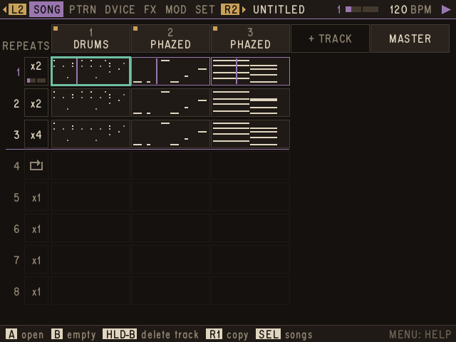

# Apotheca

**New here? Install it: [INSTALL.md](INSTALL.md).**

A pocket music workstation for Linux handhelds (first target: Anbernic
RG40XXV, 640x480, buttons only). Part of the Shapetaker family.
<br>



The full player manual — every screen, every gesture — lives in
[docs/manual.md](docs/manual.md). What follows is the project in brief.

## Status

A small song machine that runs, at 48 kHz. Up to twelve tracks, each a drum
kit, a sampler, or one of seven synths: Phazed (phase distortion, 113 presets), JAX-EP
(a virtual analog synth modeled after a popular DCO synth, 158 presets), FM-6 (six-operator
FM, after a classic 80s synth, 233 presets), PHYSIC (plucked and struck sounds that ring by
themselves: strings, mallets, bells, 112 presets), ACID (a mono bass with accent and slide,
after a classic bass line box, 64 presets), CLOUD (clouds of grains from your recordings,
48 presets) or MORPH (wavetables, swept from wave to wave, 64 presets). Up to 64 scenes of
one to eight bars, each with its own repeat count. Four screens:

- **SONG**: tracks across, scenes down. Add tracks, set how many times each
  scene plays, copy cells and scenes with R1.
- **PATTERN**: a drum grid (levels, nudge, chance, paint, lane dice, a live human feel and swing for each lane) or, for
  a synth, a piano roll on its side (keys across, time down) with chords
  from chord packs.
- **DEVICE**: for a synth, a main panel of folder, preset and eight macros,
  with advanced pages behind it (nine for Phazed, five for JAX-EP, eight for FM-6, five for PHYSIC, three for CLOUD, five for MORPH).
  For drums, the kit: each lane plays its built-in drum or a recording.
- **FX**: three effects on each track, two on the master, and two shared ones (ECHO and SPACE) that every track can send to.

Songs are kept as you go: there is no save button. A **rev** keeps the song
as it is at one moment, to go back to.

While it plays, the top bar of every screen shows which scene is playing and
how far through it is: one block for each time the scene plays, filling as
the bar goes by.

A sound designer web page (see the manual) sets a synth's sounds,
a sampler's and a drum kit's, from a computer's browser. The handheld makes
its own WiFi hotspot too (HOTSPOT on the SET tab).

## Build

Needs CMake, a C++17 compiler and SDL2 (`brew install cmake sdl2` on macOS,
`apt install cmake libsdl2-dev` on Debian/Ubuntu).

```
cmake -B build
cmake --build build
ctest --test-dir build      # engine, song, both synths, screens, app, saving, chord, sample and transfer tests
./build/apotheca            # the app
```

## Manual

The manual moved to [docs/manual.md](docs/manual.md): all four screens, both tabs,
every synth, the sampler, effects, automation, WiFi, and the file formats, with
screenshots.

## Build for the handheld

```
scripts/build-handheld.sh
```

Runs on Linux (needs clang, lld, curl, dpkg-deb, zip). It writes
`build-handheld/Apotheca-port.zip`:

```
Apotheca.sh         the launcher the Ports menu shows
apotheca/apotheca   the program
apotheca/*.ttf      the lettering
apotheca/licences/  licences of the code and lettering built in
```

Unzip it into the firmware's ports folder on the SD card, beside the other
ports. If it fails to start, the reason is in `apotheca/apotheca.log`.

The program asks the device for only two things: the C library (version 2.29
or newer) and SDL2. `cmake/toolchain-aarch64.cmake` is a second route, for
building the engine and its tests alone.

## Layout

```
engine/   the audio engine. No SDL, no device code, so it tests on its own.
app/      window, audio device, buttons, and the screens. Talks to the
          engine through commands. app.hpp ties the screens together.
tests/    engine tests, and screen tests that press the buttons.
third_party/  stb_truetype, which reads the font (public domain);
          easycz, the engine behind Phazed, copied unchanged from
          joshpanzarella/schwung-easycz (MIT, with a BSD-3-Clause chip
          emulation from MAME); msfa, the FM core behind FM-6
          (Apache 2.0, changed: third_party/CHANGES.md); and signalsmith,
          which stretches recordings to fit the tempo (MIT).
tools/    render_demo, which renders a short piece to a WAV file.
cmake/    cross-compile settings.
scripts/  the handheld build and the port launcher.
```

## Rules

- **Nothing in the audio thread may wait.** No allocation, locks, files or
  printing inside `Engine::render()` or any `Effect::process()`.
- **The screen thread talks to the engine only through `Engine::send()`.**
- **The engine never includes SDL.**
- **One button and the stick, not a combination.** New controls follow the
  rule on the Pattern screen: the stick moves; hold a button and it shapes.
- **Fast.** Held input runs quickly. Nobody has asked for slower.
- **The first synth is called Phazed.** That is the only name a player sees. Its
  engine lives in `third_party/easycz` under its own names and licences;
  anything from it that reaches the screen goes through
  `engine/include/apotheca/phazed.hpp`.
- **Handheld first.** A feature is designed on the handheld's buttons. A
  keyboard key only ever stands in for one of them.
