# Apotheca manual

A pocket music workstation for the Anbernic RG40XXV: songs made of scenes,
drum grids and piano rolls, eight synths, a sampler, effects, automation,
and files over WiFi. Everything below is also true on the device's screens;
the bottom bar always says what the buttons do where you are.

- [SONG](#song)
- [PATTERN, drums](#pattern-drums)
- [PATTERN, a synth](#pattern-a-synth)
- [Note effects](#note-effects)
- [Chords](#chords)
- [Chord effects](#chord-effects)
- [DEVICE, drums: the kit](#device-drums-the-kit)
- [DEVICE, the sampler](#device-the-sampler)
- [DEVICE, a synth](#device-a-synth)
- [ACID](#acid)
- [CLOUD](#cloud)
- [FM-6](#fm-6)
- [MORPH](#morph)
- [PHYSIC](#physic)
- [FX](#fx)
- [MOD: a knob that moves by itself](#mod-a-knob-that-moves-by-itself)
- [Automation](#automation)
- [Longer phrases](#longer-phrases)
- [A scene of any length](#a-scene-of-any-length)
- [A scene's own tempo and meter](#a-scenes-own-tempo-and-meter)
- [Next scene: carry on from a copy](#next-scene-carry-on-from-a-copy)
- [Bouncing: getting a song out](#bouncing-getting-a-song-out)
- [Step effects](#step-effects)
- [FEEL: a lane played by a hand](#feel-a-lane-played-by-a-hand)
- [THROW](#throw)
- [Slices: chopping a break](#slices-chopping-a-break)
- [The list of recordings](#the-list-of-recordings)
- [Files over WiFi](#files-over-wifi)
- [Songs](#songs)
- [Revs](#revs)
- [Presets](#presets)
- [The sound designer](#the-sound-designer)
- [SETUP (the SET tab)](#setup-the-set-tab)
- [Stop all sound](#stop-all-sound)
- [The envelope](#the-envelope)
- [The same on every screen](#the-same-on-every-screen)
- [A USB keyboard](#a-usb-keyboard)
- [All four cores](#all-four-cores)

**The first start on the handheld sets up the controls.** Apotheca asks for
each button in turn ("PRESS A", "PRESS B"...) and learns what this handheld
sends for it, whatever the firmware calls it. It takes about twenty seconds,
once. MENU and the stick may be left out by waiting eight seconds, for a
device that has none or keeps MENU for itself. The answers are kept in
`controls.txt` in the `apotheca` folder.

**To set them up again** (another handheld, or a button learned wrongly),
either of two ways:

- **SETUP screen, CONTROLS row:** hold A for a second.
- Delete `controls.txt`.

The setup learns triggers that rest at one end of their travel (many L2 / R2
do) as well as ones that rest in the middle. SETUP also has a **button
test**: it lights each button while Apotheca hears it held. One that stays
lit, or never lights, was learned wrongly.
The bottom of the setup screen shows what the handheld last sent: if it
stays at "nothing yet" while you press buttons, the firmware is not passing
them on, and `apotheca.log` and `device-info.log` will say what it has.

**The handheld comes first.** Every action is defined on the Anbernic
RG40XXV's own buttons, named as printed on it. The keyboard is only a
stand-in for testing at a desk: each key presses one handheld button, so the
keyboard can do nothing the handheld cannot.

**The handheld has one stick, and one rule for it.** With nothing held it
moves the cursor (so does the D-pad; hold either and it runs). Hold a button
and the stick shapes the thing under the cursor:

| Held | The stick |
| --- | --- |
| Nothing | Moves the cursor |
| A | Turns the value: it fills or drains |
| Y | Chance, on the drum grid |

**Hold MENU (the small button in the middle) and a help card comes up**: what the buttons do
on every screen (X hears what is under the cursor, on SONG it solos the track; the stick and D-pad
move, A, B, START, L2 / R2, what SELECT does with other buttons, how to
stop all sound), and the **battery**. Let go and it closes. On a handheld whose firmware keeps MENU for
itself, holding SELECT for a moment does it instead.

**Above the battery the card says how hard the handheld is working**, a new
reading each second while it is open:

| Word | Means |
| --- | --- |
| SOUND 43% | Over the last second, making the sound took 43% of the time that sound lasts. At 100% or over it cannot keep up, and the sound stutters |
| CPU 37% | The whole program (the sound, its helpers, the screen, the WiFi page) as a share of the whole processor, all its cores together. 25% on a four-core handheld is one core kept busy. Shown from a second after the card opens |

Measuring costs nothing you could notice: two looks at the clock for each
slice of sound (about 50 billionths of a second, 0.001% of a slice). The bar at the bottom of each screen lists
only what is particular to where the cursor is. A direction that either the
stick or the D-pad gives is written as the direction alone (UP / DOWN); the
two are named only where they do different things. The bar never runs off
the screen: a hint that does not fit is left out.

**While X is held on a hit, a note or a chord, each button stands right under
the thing it sets**, with no word beside it: the name above it says what it
is. The arrows under RATCHET set the ratchet, A under THROW throws. Y and the
die at the left roll all of it. A field with nothing under it (NUDGE on a
note) is not set from there. Where THROW stands at the right-hand end (a drum
hit, a chord) its button takes the place of the words about the help card.

**SELECT + B is undo; SELECT + A puts it back.** Twenty steps deep. One
step is one burst of editing: a paint stroke, a roll of the dice, a cell
emptied, a chord placed, a pass of automation. It covers what is in the
patterns (hits, notes, chords, automation, how long each cell is, how often
each scene plays), and also each track's effects and their settings (a
TYPE changed comes back with its old settings and automation), its sends,
its sound (preset, settings, macros), its GLIDE FROM, the master's effects
and the buses' (their LEVEL too). Tempo, mutes, names, the kit's recordings
and a track deleted or given another instrument are not. The song keeps
playing while you undo.

**L2 and R2** walk along the screens: SONG, PATTERN, DEVICE, FX, MOD, SET.
The bar at the top writes PATTERN as **PTRN** and DEVICE as **DVICE**, to give
the six tabs room; this manual keeps the full words.
**SELECT**, tapped by itself, goes to SONG from anywhere (and on SONG opens
the list of songs). **START** plays and stops: the song from
the SONG screen, the scene being worked on from the others. A stop fades
sounding samples fast, so nothing plays on. **SELECT + START**
quits.

## DEVICE, the sampler

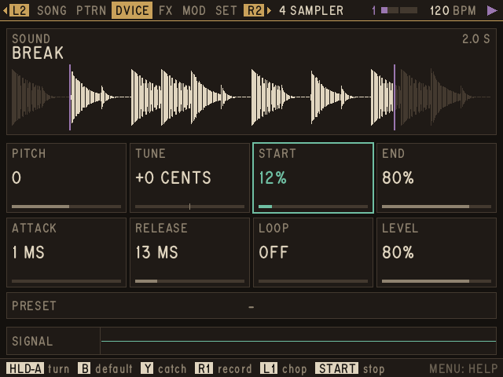

A fourth instrument in the + TRACK list. **One recording, played from the
keys**: the piano roll and the chord button work on it as on a synth. Middle C
plays the recording as it was made; an octave up, twice as fast.

| On | Hold A + up / down | B |
| --- | --- | --- |
| SOUND | **Tap A: the list of recordings.** Or hold A + up / down: one at a time | None |
| PITCH, TUNE, START, END, ATTACK, RELEASE, LOOP, LEVEL | The stick turns it; the D-pad moves it by one | Its usual value |
| PRESET | The preset after / before: the ends stop | Held a second, on one of your own: deletes its file (the track keeps its sound) |

**PRESET is the sound kept as a preset of its own** (or "-"): the
recording, its settings, CHOP and the whole sound around it, as a synth's
save keeps. **R1 on it saves the track's sound under a name**: the keys come
up (A types, Y deletes, B leaves without saving, START saves, 24 letters at
most); under a name taken, it replaces that one. A preset is kept as
`NAME.sampler` in `presets` beside the program.

**A multisample**: where the files beside the picked one spell notes in
their names (C2, C#3, Db3), they play too, each round its own note — up to 24
notes, split halfway between their notes. The picked one plays at its
spelled note, or where PITCH says where it spells none; PITCH moves the whole
set as it moves one recording. The song still names only the one picked, and
the picture says how many play (3 ZONES).

**Velocity layers**: several recordings of one note, played soft to hard.
A harder note plays a harder recording. The layer is read from a word in the
name:

| In the name | Softest to hardest |
| --- | --- |
| A dynamic | PPP, PP, P, MP, MF, F, FF, FFF (not as the name's first word) |
| A word | SOFT, MED or MEDIUM, HARD or LOUD |
| A number | V1, V2... (also VEL, VL, VELOCITY or LAYER), or straight after the note: A0V1 |

A file with no layer word counts as MF. A note's layers share its notes'
range of loudness evenly: with three, the softest third of the notes plays the
first. A note placed on the piano roll (90%) plays the hardest; turn a note's
level down to reach the softer ones, or play a USB keyboard. **Layers need no
note in the name**: "Snare", "Snare soft" and "Snare hard" in one folder are one
sound in three layers, at its own pitch on middle C, as one recording is
(PITCH moves it). At most 4 layers a note and 48
recordings in all: with many notes, fewer layers each (the softest and the
hardest kept first). The picture says it: 6 ZONES  3 LAYERS. A big set takes
a moment to load.

**CHOP (L1)** cuts the one recording into 16 even slices, C1 up: each key
plays its slice at its own pitch, PITCH moving every slice together. START,
END and LOOP work within the slice played. Not with a multisample: where one
is loaded its zones play instead.

**START and END are where a note begins and ends in the recording**, in
percent of it: a note plays from START to END and stops, and with LOOP on it
goes round between the two. END is beside START and starts at 100% (the
recording's end). **They never cross**: turned toward each other, each stops a
percent short of the other. The recording's picture marks both in purple and
lights only what a note plays.

**PITCH is semitones up or down, and up is higher.** (It used to be ROOT, a
key, which ran the other way. Old songs open as they were.) **X hears it at
middle C**: its own pitch at PITCH 0, and the change when PITCH or TUNE is
moved. **Hold X and it plays for as long as you hold it**, to the end of the
recording; let go and it stops (its RELEASE runs). A tap plays a moment
(0.35 s), as before. Pressed again, it starts again from the top. A setting
is also heard as it is changed, when the song is stopped.

**Y is Catch** here too: the last bar the song played becomes this track's
recording. Eight notes at a time.

## The list of recordings

**Tap A on SOUND** (a kit lane, or the sampler) and the recordings come up
in **three columns**: the folder this one is in, this folder with the cursor
in it, and what is under the cursor (a folder's contents, or a recording's
waveform and length). **The columns stand still**: on SAMPLES the cursor is in
the first column, the folder under it is shown in the second and the
recording's picture is already open in the third, so going into a folder only
moves the cursor one column right. Inside a folder the cursor is in the middle
column. It opens in the folder of the recording that is on, on it.

| Button | Does |
| --- | --- |
| Up / down | The next in the column. A recording goes on **at once**: with the song playing you hear it in the beat; stopped, **half of it plays** (from where it plays from: the sampler's START), and it stops as soon as the cursor moves on. Held: a steady pace, faster after a second and a half |
| The stick | Big moves: up to fifteen rows a second pushed all the way. Going by that fast, the one you stop on goes on, not each one passed |
| Left / right | Out to the folder this one is in / into the folder under the cursor |
| **L1 / R1** | A page up / down |
| **Hold R1** | On a recording: **carry it**. Keep R1 down and steer (D-pad, stick, L1) to a folder, or into one; let go and it is there. The top line says where it would go. Let go on a row of SAMPLES that is no folder: out of every folder. **B with R1 held calls it off** |
| A | On a recording: keep it. On a folder: into it. On **+ NEW FOLDER**: type its name (A types, Y deletes a letter, **B makes the folder and leaves**, as START does; with nothing typed B leaves and makes none) |
| B | A tap: put back what was there before the list opened |
| X | **While it is still playing: it plays on to its end.** Nothing playing: hear it again; **held, it plays until you let go**, or to its end; a tap plays a moment |
| **Hold B** | For a second: **delete** the recording under the cursor from the handheld (a bad catch, a take not wanted). Lanes that were using it go back to their drum. Or an **empty folder**: one with anything in it is never deleted |
| START | Play / stop, with the list still open |

**Folders.** Folders inside `samples` (kicks, breaks, vocals...), and
folders inside those: **two levels**, `drums/kicks/808`. A folder inside
that is not looked into. **Make one on the handheld** with + NEW FOLDER, the
last row of SAMPLES and of each first-level folder (twelve letters at most,
kept in small letters), or on the WiFi page.

**A recording carried to another folder keeps playing**, and nothing is
lost: the open song, every saved song and every rev that used it name it
where it is now. It is not moved where one of that name already is, or where
its name with its folders would pass 63 letters; the top line says which.
The folder it left stays, even empty. The first column, SAMPLES, lists the first row (the
built-in drum, or no recording), UNSORTED (the recordings not in a folder)
and each folder with how many recordings are under it. With no folders at
all the recordings are listed there themselves. Under a recording's picture
the list says if it is on elsewhere in the song. Catches go in `catches`,
takes from a microphone in `recorded`, by themselves. A song keeps a
recording as `folder/name` or `folder/inner/name`, 63 letters at most in all.

**A recording that has moved is found again.** When a song is opened and a
recording is not where the song says, Apotheca looks through `samples` and
its folders for one of the same name (the part after the folder). If there is
exactly one, the lane or sampler track takes it and the song is saved with the
new place. If there are two of that name, or none, it does not guess: the lane
says NOT IN THE SAMPLES FOLDER and its built-in drum plays; a sampler track is
silent. So files can be sorted into folders on a computer, with the card out,
and the songs still find them. Renaming a file that way does break the link
(rename on the WiFi page instead: see Files over WiFi).

**A line runs across the picture while a recording is heard**, here and on
the kit's rows and the sampler's own picture. It is timed, not measured:
right for a recording played as it is, near enough for one tuned up or down.

## FX

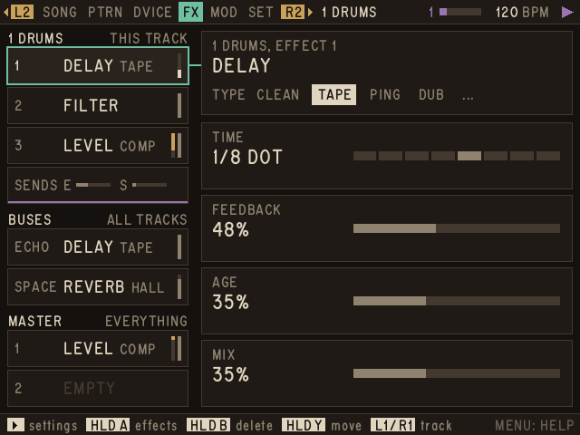

A fourth screen, after DEVICE. **Two columns, and everything is in view.**

| Column | Holds |
| --- | --- |
| Left: the list | Eight lines, always there. **THIS TRACK**: its three effects, one after the other, then its **SENDS** (how much of it goes to ECHO, how much to SPACE). **BUSES**: what **ECHO** and **SPACE** hold, one effect each, shared by every track. **MASTER**: the two effects on everything, after the tracks are mixed. |
| Right: the line picked | Large. A heading (where it is, the effect, its TYPE, what it is doing just now), then each setting as a wide row: its name, its value, a bar. For SENDS: the two sends. |

Both columns go down to the hints bar.

Each line of the list says what it holds (DELAY TAPE, LEVEL COMP, or
EMPTY). Where the type is the family's own word it says it once (FILTER,
DRIVE); where the two are too long for the line, the type alone (SATURATE). The small
upright mark at its end is how much of the effect there is (its MIX, or a
bus's LEVEL). COMP and DUCK have a second, brass mark: what they are doing
to the sound just now.

| Where | Button | Does |
| --- | --- | --- |
| The list | Up / down | The next line. All eight, round the ends. |
| | Right | Into the line's settings, **at the one last used there** |
| | **Hold A** | **The list of effects opens on the right**: the seven families, each line naming its types. Up / down steps through it, and you **hear** each one at once, but it is only **tried**: the effect that was in the slot, its settings and its automation are kept aside. **Let go of A** and the one you are on goes in (another family at its usual settings, its automation gone). Let go on the effect you started on and it is back exactly as it was. |
| | Hold A + left / right | The **TYPE**, for an effect that has types. Tried too, with the settings the two types share; let go and it goes in, its automation moved with it |
| | Hold A, then **B** | **As it was**: nothing tried goes in. Leaving the screen or the track with A held does the same |
| | Hold B | **Deletes the effect**, with its settings and its automation: a bar fills for a second, and the heading says DELETING: CANNOT BE UNDONE. Let go sooner and it stays. On SENDS a tap of B: nothing sent. |
| | Hold Y + up / down | On one of the track's own three lines: **moves it** there, settings, automation and MODs with it. The cursor goes with it; the ends stop. One step of undo. The buses' and the master's never move. |
| The settings | Up / down | The next setting |
| | Left | Back to the list, on the same line, from any setting. (Right does nothing here.) |
| | **Hold A + left / right** | **The TYPE before / after** (COMP to DUCK), at once, in the same grip that turns the value: the cursor stays on its row. The first and the last type stop. |
| | Hold A + up / down | The stick turns it. The D-pad moves it a twentieth, or to the next choice. |
| | B | Its usual value. A send: nothing sent. |

**A slot remembers each type's own settings.** Turn a COMP, switch to the
DUCK, then back: the COMP is exactly as you left it, not rebuilt from the
DUCK. A type the slot has not held yet starts with what it shares with the
one before. This holds for Hold A + left / right in the list too. It is kept
only while the program runs, not in the song file, and it is forgotten when
another family or EMPTY goes in the slot, another song opens, or the track is
deleted or given another instrument. Automation does not come back with a
type: it follows the settings the two types share, as any change of TYPE
does. Undo after a switch puts back the type before, with its settings.
With A held on a setting the heading's TYPE row shows the key that switches
(RIGHT, LEFT, or LEFT / RIGHT): no RIGHT on the last type, no LEFT on the first.

Two things to know. "Exactly as you left it" includes MIX, and LEVEL on a bus:
turn a bus down on PING, go back to TAPE, and TAPE's own LEVEL is back. And
automation is not kept that exactly: a line both types have comes back
rounded where their scales differ, and a line only one has is cleared (undo
brings it back).

**L1 / R1** is the track before / after, from the list or from a setting: the
cursor stays on the same line and setting, and the top bar names the new
track. It stops at the first and the last track, as the SONG screen does.

X hears the track and START plays, as everywhere (a recording, on lane 1 or
the sampler, plays for as long as X is held). Y does nothing here.

**The list of effects** is seven families, each with a TYPE:

| Family | Types |
| --- | --- |
| FILTER | FILTER |
| DRIVE | **DRIVE**, **SATURATE** |
| CRUSH | CRUSH |
| MOD | **CHORUS** |
| DELAY | **CLEAN**, **TAPE**, **PING** |
| REVERB | **ROOM**, **HALL**, **SPRING**, **PLATE** |
| LEVEL | **COMP**, **DUCK** |

Each family's line names its types ("clean, tape, ping"), and the one in the
slot is lit, so you see what is inside before you pick. FILTER and CRUSH
have one type, called as the family is: their lines say what they do. The
heading's TYPE row shows the types too, the one it is on a plate (as many as
fit, "..." for the rest). An ECHO bus's list is EMPTY and DELAY; a SPACE
bus's, EMPTY and REVERB. Old songs are untouched: each type is the same
effect it always was.

**Changing TYPE keeps what the two types share.** TIME, FEEDBACK and MIX go
from CLEAN to TAPE and back (and to PING, with TONE too between CLEAN and
PING); SIZE and MIX from ROOM to HALL; DECAY, TONE and MIX from HALL to
SPRING (from ROOM to SPRING, MIX alone), and from HALL or SPRING to PLATE
(from ROOM to PLATE, MIX alone); DRIVE, TONE and MIX between DRIVE and
SATURATE. COMP and DUCK share nothing: the new one starts at its usual
values. They are kept
**as they read**: TAPE's FEEDBACK goes to 120% and CLEAN's to 100%, and 48%
stays 48%. What the other type cannot read goes to the nearest it can (120%
becomes 100%; a triplet TIME becomes the nearest plain one). A setting the
new type does not have is dropped, and its own extra settings start at
their usual values. Automation follows the settings that are kept.

A setting that is a choice (a TIME, a filter's TYPE, COMP's RATIO) has no
bar to be somewhere along. It has **one piece for each choice, and the one
it is on is lit**.

**A setting that moves with the pattern** (see Automation) has a purple
line under its row and says so; its line in the list has a purple line too.

### ECHO and SPACE: one delay and one reverb for the whole song

A **send** is a copy of a track fed to a shared effect. ECHO holds a delay,
SPACE holds a reverb. Each track says how much of itself goes to each, from
0 to 100%, on its SENDS line. Both start at 0.

| | An effect on the track | A send |
| --- | --- | --- |
| How many run | One for each track that has it | One for the whole song |
| How much | Its MIX | The track's ECHO or SPACE amount |
| The sound | Each track in its own room | Every track in the same room |

- **What ECHO and SPACE hold is in the list, under BUSES.** Their settings
  are the delay's and the reverb's, but for the last: **LEVEL**, how loud the
  echoes or the room come back. It starts at 100%.
- ECHO takes only a DELAY (CLEAN, TAPE or PING) and SPACE only a REVERB (ROOM,
  HALL, SPRING or PLATE): hold A there and that is all the list offers. Hold B deletes one.
- On ECHO or SPACE an effect gives back only what it adds: the echoes or the
  room, never the sound itself a second time.
- **LEVEL turned right down keeps the echoes going round.** Turn it up again
  and they are still there. A bus goes quiet for good only when its echoes
  have really died away.
- The send is taken after the track's level and its mute: a muted track sends
  nothing, and the echoes it already made ring on.
- The master's effects come after, so they act on the echoes and the room too.
- A send can be **automated** like any setting (see Automation).
- **THROW** sends one drum hit or one note in full, whatever the SENDS line
  says: hold X on it and press A. See "THROW" under PATTERN.
- **A new song has DELAY (TAPE) on ECHO and REVERB (HALL) on SPACE.** So does a song made
  before there were sends: nothing in it is sent, so it sounds as it did, and
  the first send turned up in it gives what it gives in a new song. CLEAN and
  ROOM, the older two, are one push away (hold A + left on the line).
- **A song saved here and then opened by an older version of the program
  loses its sends, its throws, its third effects and what ECHO and SPACE hold.** The rest
  of it opens.

In the table below, **TAPE**, **PING** and **DELAY** are the DELAY's three types
(TAPE, PING and CLEAN), and **HALL**, **SPRING**, **PLATE** and **REVERB** the REVERB's (HALL,
SPRING, PLATE, and ROOM). A
song file calls each by the name it has always had.

| Effect | Settings |
| --- | --- |
| FILTER | Cutoff, resonance, type, mix. Types: LOW 12 DB (two poles, gentle), LOW 24 DB (four poles, steep), BAND PASS, HIGH PASS, and DJ: one knob, nothing in the middle, turned down it closes from the top, turned up it clears out the bottom. |
| SATURATE | Drive, type, tone, mix. Clean drive: the newer of the two, far smoother on high notes than DRIVE. DRIVE is how hard the sound is pushed; **the loudness stays about level as it rises**, so it is the grit that changes and not the volume (a quiet sound comes up, a loud one comes down). Types: TAPE (soft and even), TUBE (lopsided: warmer, with a touch of the octave), FOLD (past the top the wave folds back down: hollow, then metallic), HARD (straight, then flat: a clipper). TONE takes the top off afterwards. |
| DRIVE | Drive, tone, mix, output. The older one: rougher up high, and louder as it is driven. Songs made with it sound as they did. |
| TAPE | A tape echo: each repeat is duller, thinner and a little bent. **Time** (1/16, 1/8 triplet, 1/8, 1/4 triplet, dotted 1/8, 1/4, dotted 1/4, 1/2: it follows the tempo; a triplet, shown as TRIP, is three in the space of two; a dotted one, shown as DOT, is half as long again), **feedback** (to 120%), **age**, **mix**. Turn TIME while it sounds and the echoes swoop in pitch, as tape does when its speed changes. FEEDBACK past 100% howls and holds there; it does not blow up. **It does not howl for ever either**: while sound is coming in, and for 30 seconds after the last of it, FEEDBACK is what it reads; left alone longer than that, a FEEDBACK over 90% eases back to 90% and the echoes die away. Play into it again and it is back at once. A FEEDBACK that reads 90% or less is never touched. AGE is how worn the tape is: more wobble in pitch, duller and thinner repeats, a lower ceiling on the howl. MIX is how loud the echoes are; the sound itself stays as it is. |
| PING | A clean echo that bounces from side to side: the first repeat on the left, the next on the right, and so on. **Time** (TAPE's eight choices), **feedback** (0 to 100%, as CLEAN's: how much of each repeat is in the next. Like CLEAN it does nine tenths of what it reads, so it cannot ring for ever), **tone** (how bright the repeats stay: low is duller each time across), **mix**. A sound in the middle, or on one side only, bounces all the same. The first repeat is the sound exactly as it was. Turn TIME while it sounds and the echoes swoop in pitch, as TAPE's do. |
| DELAY (the type CLEAN) | Time (1/16, 1/8, dotted 1/8, 1/4, dotted 1/4, 1/2: it follows the tempo; dotted is shown as DOT), feedback, tone, mix |
| HALL | A reverb with a dense tail that keeps moving. **Size** (the room, and the gap before it answers: 2 to 30 ms), **decay** (how long the tail lasts, in seconds: 0.3 to 20), **tone** (low is dark: the highs die soon; above the middle it is bright and the lows are thinned), **mix** (from the sound alone to the room alone). Turning SIZE while it sounds bends the room's pitch for a moment. |
| SPRING | A spring tank: the boing. In a spring the high notes travel slower than the low ones, so a click comes back as a quick sweep, low first, and each time round it is longer. **Drip** (how strong that sweep is; at none, plain echoes), **decay** (how long the tail lasts, in seconds: 0.4 to 4), **tone** (low is dark: the highs die soon), **mix**. Like a real one it passes little under 100 Hz or over about 4.5 kHz, takes the left in at one spring and the right at the other, and gives it back a little different on each side. Changing TYPE from HALL keeps DECAY as the seconds it reads, or the nearest SPRING has. |
| PLATE | A plate reverb: a dense wash from its first moment, with no early echoes to pick out, bright and smooth, and an even fall. **Pre** (a gap before it answers: 0 to 100 ms), **decay** (how long the tail lasts, in seconds: 0.3 to 20, as HALL's), **tone** (low is dark; high is bright; at any setting the lowest notes die a little sooner than the rest), **mix**. Left and right go in together, as on a real plate, and come out wide. Turning PRE while it sounds bends its pitch for a moment. |
| REVERB (the type ROOM) | The older, plainer reverb. Size, damping, mix |
| CHORUS | Rate, depth, type, mix. Copies of the sound, a little late and wavering, which makes one sound into several and spreads it left and right. RATE is how fast they waver (0.1 to 8 times a second), DEPTH how far. Types: CHORUS (three copies a side), ENSEMBLE (three copies, each at its own speed: thicker, less regular), VIBRATO (the pitch itself wavers; at full mix there is no plain sound), FLANGE (one very short copy fed back into itself: the jet sweep). |
| WAH (a FILTER type) | Sense, speed, resonance, mix. An auto-wah: **a filter that opens as you play.** A hit opens it and it closes as the sound dies away: the "quack" of a funk bass or a clavinet. Nothing turns it but the playing. SENSE is how far a sound opens it (low: only the loudest hits open it a little; high: a quiet one opens it all the way, 250 HZ shut to 3.5 KHZ open). SPEED is how fast it follows, read as two times: 2/60 MS (in fast, back fast: a quack on every note) to 30/600 MS (a slow swell). RESONANCE is how much it sings at the top of its sweep; it reads as FILTER's does, and stays where it was when TYPE changes from FILTER or VOWEL. MIX at 0 is the sound untouched. |
| PITCH (a MOD type) | Pitch, fine, grain, mix. **The sound again, higher or lower**: an octave under a bass, a fifth over a lead. PITCH is -12 to +12 semitones (ST), one click each. FINE is -50 to +50 cents on top (a cent is a hundredth of a semitone): a few either way at half MIX thickens a sound, as two players a hair apart. GRAIN is how long each piece it reads is, 20 to 120 MS: short follows fast playing but buzzes on low notes; long is smooth but blurs fast playing. MIX at 0 is the sound untouched; at 100% only the shifted sound is left. At PITCH 0 and FINE 0 the shifted sound is the sound a GRAIN late, so with MIX part way it sounds hollow (a comb), as any shifter does. It starts an octave up at half MIX. |
| COMP | Threshold, ratio, speed, mix. A compressor: it turns the loud parts down and then the whole up, so a sound is more even and sits forward. THRESHOLD is how loud "loud" is (-48 to 0 dB: lower catches more). RATIO is how hard (1.5:1, 2:1, 3:1, 4:1, 8:1, 20:1). **While sound passes, a thin line under the THRESHOLD bar shows how far it is turning the sound down**, and the heading says it in words (TURNING DOWN 7 DB): it grows from the right, and the whole width is 24 dB. No line: the sound is under the threshold and nothing is done to it. SPEED is how fast it acts and lets go, as one knob: it reads both, from 1/50 MS (it catches every hit) to 30/400 MS (hits get through, the whole is held together). MIX part way keeps the plain sound beside the squashed one. The level comes back up by itself. It does not listen below 60 Hz, so a kick's thump does not pull everything down. **On the master it glues a mix together.** |
| DUCK | Amount, release, source. **The track dips each time a drum is hit**, and comes back up: the pumping sound, or room made for the kick. SOURCE is which drum: a lane, 1 to 8, of the **first drum track** in the song (lane 1 is the kick in the built-in kit). AMOUNT is how far it dips (100%: right down to nothing). RELEASE is how long it takes to come back, 20 ms to 1 second. It goes by the hit itself, not by the drum's sound: it works with the drums muted or that lane turned right down, every hit counts whatever its level (each hit of a ratchet, and a drum played by hand), and a step that its chance leaves out does nothing. **A thin line under the AMOUNT bar shows how far it is dipping**, and the heading says DIPPING 3 DB, as COMP's does. On the master it dips the whole song. Not for ECHO or SPACE. |
| CRUSH | Bits, rate, mix |

Effects are kept in the song. They can be changed while it plays. Stopping
all sound empties their tails.

TAPE, PING, HALL, SPRING, PLATE, CHORUS, COMP, SATURATE and DUCK are new. Their settings slide to where
they are turned instead of jumping, so they can be turned while sounding
without a click. A song that uses one, opened by an older version of the
program, loads without that effect: the slot is left as it was.

## Stop all sound

**Hold all four shoulder buttons (L1, L2, R1, R2).** The sound is shut off
within 5 milliseconds and stays off for as long as they are held. The song
stops, every drum is cut and every note is let go. It works on every screen
and changes nothing else.

Let go, and the sound opens again once whatever was left has died away, or
at the next thing you play, or after three seconds at the latest. The top
bar says SILENCED until it has.

A notice comes up (ALL SOUND STOPPED), in case it was an accident. Once
the buttons are let go, any button puts it away (that press does nothing
else), or it goes by itself after four seconds.

## SETUP (the SET tab)

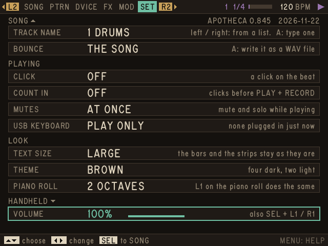

**Which version this is** shows at the top right of the SET tab (and on the
help card, the WiFi page, and the first line of `apotheca.log`): `0.104`
and the day it was built. The number goes up by one with every build.

The rows stand under five headings: **SONG** (TEMPO, CHORD PACK, KEY, SCALE,
TRACK NAME, BOUNCE), **PLAYING** (CLICK, COUNT IN, MUTES, USB KEYBOARD), **LOOK** (TEXT
SIZE, THEME, PIANO ROLL), **HANDHELD** (VOLUME, BRIGHTNESS, STICK LIGHT, LIGHT
COLOUR, RING LEVEL, STICK SPEED) and **SETUP** (WIFI PAGE, NETWORK, HOTSPOT, BUTTONS, CONTROLS). The page moves
a row at a time; a small arrow after a heading says there are rows out of sight
that way.

| Row | Left / right | A |
| --- | --- | --- |
| TEMPO | A beat a minute | **Tap it in time**: from the second tap the tempo is the beat of the last five taps (a pause of two seconds starts again). The box above the bar says TAPPED: 117 BPM |
| CHORD PACK | Another pack | |
| KEY | The song's key, C to B (round) | |
| SCALE | **SCALE LOCK**: CHROMATIC (no key: every key, the usual), MAJOR, MINOR, DORIAN, PHRYGIAN, LYDIAN, MIXOLYDIAN, LOCRIAN, MAJOR PENT, MINOR PENT, HARMONIC MINOR, BLUES. On, the piano roll's cursor steps left / right only through the scale's keys (and any key a note of the bar shown is on, so it can still be reached), the keys out of it are drawn dim, a note carried sideways (hold R1) goes to the next key of the scale, and the chord pack's chords are moved into the key (a major pack in a minor scale to its relative major: C major's chords in A minor stay C, Dm...). Kept in the song; a step of undo | |
| TRACK NAME | A name for the track being worked on, from a list | **Type one**: a grid of letters and numbers. A types, **Y deletes a letter, B keeps the name and leaves** (with nothing typed B leaves and the name stays as it was), START keeps it too (with nothing typed: the instrument's own name). Ten characters. |
| VOLUME | A twentieth | |
| BRIGHTNESS | The screen, 10% to 100% in fives (also **MENU + the volume keys**, ten at a time). **Only on Apotheca's own system for the RG40XXV** | |
| STICK LIGHT | The light round the stick: OFF, ON (steady, in LIGHT COLOUR), BEAT (a flash on every beat while the song plays), STEPS (the ring goes round once a scene: its sixteen lights share the scene's length, the bar's first step in brass). **Only on Apotheca's own system** | |
| LIGHT COLOUR | The ring's colour: THEME (a colour picked for each theme: BROWN's is BRASS, DRACULA purple, NORD frost blue, GRUVBOX orange, TOKYO indigo, MONOKAI lime, SOLARIZED cyan, GITHUB blue), TEAL, PURPLE, BRASS, RED, ORANGE, YELLOW, GREEN, BLUE, PINK, WHITE, TRACK (a colour for each track: the track you are on; while it is chosen each track's head on the SONG screen wears a thin bar of its colour along its foot, so the ring can be matched to a track), RAINBOW (each light its own colour, turning a light a beat while the song plays). **Only on Apotheca's own system** | |
| RING LEVEL | The ring's own brightness, 10% to 100% in fives, apart from the screen's. **Only on Apotheca's own system** | |
| STICK SPEED | 25% to 150%, kept for next time | |
| TEXT SIZE | SMALL, MEDIUM, LARGE or XL, kept for next time | |
| THEME | The colours: BROWN, DRACULA, NORD, GRUVBOX, TOKYO, MONOKAI, SOLARIZED or GITHUB, kept for next time | |
| PIANO ROLL SHOWS | 1, 2 or 3 octaves | |
| USB KEYBOARD | PLAY ONLY, or PLAY + RECORD | |
| CLICK | The metronome: OFF, ON (a click on every beat while the song plays, higher on a bar's first), RECORDING (only while it plays with PLAY + RECORD). It is never in a bounce, and CATCH never takes it | |
| COUNT IN | OFF, or ONE BAR: with PLAY + RECORD, START clicks a bar first (the box above the bar counts 4, 3, 2, 1) and the song starts after it. START again calls it off | |
| MUTES | AT ONCE, or NEXT BAR: a mute or a solo pressed while the song plays lands on the next bar line. Until then its M or S is drawn hollow on the track's head and the track sounds as it did. Stop lands it at once; pressing it back before the line calls it off | |
| WIFI PAGE | | On / off. On Apotheca's own system the row reads the page's name (`ON apotheca.local/4821`), with the address beside it (`or 192.168.1.5/4821`) |
| NETWORK | | **Only on Apotheca's own system.** Which WiFi network the handheld is on: **hold A + up / down** through those found, let go to join (see "Joining a network" below). **Hold B** a second forgets the one joined |
| HOTSPOT | | **Only on Apotheca's own system.** On / off. On, the handheld is its own network and a phone joins it (see "Our own network" below) |
| BUTTONS | | The button test |
| CONTROLS | | Hold a second: set the controls up again |

The first three belong to the song. The rest belong to the handheld and are
kept in `settings.txt` and `volume.txt` beside the program.

The page shows twelve rows. Going down past BUTTONS moves it up a row to show
CONTROLS; a small arrow after HANDHELD (or PROJECT) says a row is out of sight
that way.

**BRIGHTNESS, STICK LIGHT, LIGHT COLOUR and RING LEVEL** show only on Apotheca's own system for the
RG40XXV (`os/README.md`), where nothing else looks after the screen's light and
the ring round the stick. On the stock firmware the firmware keeps them and the
rows are not there. A tap of the power key
turns the screen off and the ring with it. Hold **MENU** and press a **volume
key** to change the brightness from any screen (the help card goes while you
do, so you see the screen itself).

### Joining a network (Apotheca's own system only)

On Apotheca's own system for the RG40XXV the WiFi is the program's, so it is
joined here. On the stock firmware the firmware joins it and this row is not
there.

1. Turn **WIFI PAGE** on. The radio only runs while it is on.
2. Go down to **NETWORK**. It says the network joined, or NONE, and beside it
   what is going on: LOOKING..., 3 FOUND, JOINING..., WRONG PASSWORD, NOT
   FOUND, or the handheld's address once it is on. It looks for networks
   when you reach the row and again every ten seconds.
3. **Hold A** and press **up / down** through the networks found, the
   strongest first. A small lock after a name means it needs a password.
   **Let go of A** to join it. B while A is held: nothing is joined.
4. A network the handheld knows already, or an open one, is joined at once.
   One that needs a password opens the keys: three sets (small letters,
   capitals, signs), **X** turns to the next set, A types, **Y deletes a
   letter**, **B or START keep it and join** (B with nothing typed leaves).
   8 to 63 letters. What you type is shown, so a wrong letter can be seen.
5. The handheld remembers it, and joins it by itself the next time WIFI PAGE
   is turned on. **Hold B** a second on NETWORK to forget it (the row says
   FORGETTING IT: CANNOT BE UNDONE while the bar fills).

The password goes to the system and is kept in `wifi/networks.conf` on the
APOTHECA drive, as any computer keeps its WiFi passwords. It is never written
to a log.

**Our own network**: where there is no router about (a studio, the road), turn
**HOTSPOT** on instead of joining one (the WIFI PAGE comes on with it: one
tap does both). The handheld becomes an open network
called `apotheca`, a phone joins it with one tap, and the page is reached at
`192.168.4.1` (the same number after it). The page still asks for
its PIN. The phone gets no way out through the handheld and keeps its own
internet. A again turns it off: the page goes off too, unless it was on by
hand (then a saved network rejoins by itself). While
it is on, NETWORK names it and HOLD B forgets nothing.

**`apotheca.local`**: on its own system the handheld also has a name on the
network, so the page can be opened as `apotheca.local/4821` (the same
number) as well as by its address. Both are shown, on the WIFI PAGE
row and in the list of songs. Where two handhelds share a network the second
is `apotheca-2.local`. A computer that does not look names up this way
(some Windows and Android ones) still has the address.

**THEME** changes the colours, and nothing else: every box, word and mark
stays where it was. It changes at once. Six are dark and two are light. All
but BROWN take their colours from well-known editor themes, adjusted so every
word and mark is as easy to read as in BROWN:

| Theme | |
| --- | --- |
| BROWN | the look Apotheca was built with; a new handheld gets it |
| DRACULA | purple-grey, with cyan, violet, orange and coral |
| NORD | cool arctic blue-grey, with pale green, mauve and sand |
| GRUVBOX | warm brown-black, with green, rose and yellow |
| TOKYO | deep navy, with aqua, lilac and amber |
| MONOKAI | charcoal, with lime, cyan, yellow and pink |
| SOLARIZED | warm cream, light, for daylight |
| GITHUB | cool white-grey, light |

In every theme each colour keeps its job: the cursor and "on" (teal in
BROWN), automation, glides and chords (purple), a value changed from its usual
(brass), and stop and delete (red).

**TEXT SIZE** is how big the lettering is. It changes at once.

| Size | The three sizes of letter | |
| --- | --- | --- |
| SMALL | 12 / 14 / 16 | where Apotheca started |
| MEDIUM | 13.5 / 16 / 18.5 | |
| LARGE | 14.5 / 17 / 20 | what a new handheld gets; every screen was laid out at it |
| XL | 15.5 / 18.5 / 21.5 | a little bigger |

Some rows stay at LARGE whatever is chosen, because they were laid out to
the pixel: the bar across the top, the hints bar (and the buttons it draws
under a strip), the strip under the drum grid and under the piano roll, and
the controls setup. At XL a few words that would not fit their box stay at
LARGE too (a long recording's name, the help card's longest line): nothing
is cut short and nothing moves.

A still at a size, for looking: `--text-size small` (or `medium`, `large`,
`xl`) with `--view NAME --shot out.bmp`.

## The sound designer

A web page for building sounds on a computer's big screen. **The handheld
makes the sound**: the page is only the controls. Turn the WiFi page on
(SETUP), open its address in a browser, and follow "Open the sound
designer".

- It works on **the track being worked on** on the handheld, if that is a
  PHAZED, JAX-EP, FM-6, PHYSIC, ACID, CLOUD, MORPH, SAMPLER or DRUMS track. Move to another track there and the page follows.
- **A SAMPLER track** shows its recording as a picture, with **START and END
  as marks to drag** (or click: the nearer mark comes to the click). They stop
  a percent short of each other, as on the handheld. Under it are its eight
  settings, read as the handheld reads them (PITCH, TUNE, START, END, ATTACK,
  RELEASE, LOOP, LEVEL). **PLAY** (or the space bar), held, plays it at its
  own pitch; the keys play it higher and lower. The list above the picture
  picks another recording from the card (a recording sent from the WiFi page
  is in it at once, one put there another way within five seconds). The page
  does not save presets; the handheld's PRESET row does. Every change is the
  handheld's own: undo, the song file and the SAMPLER screen follow.
- **A DRUMS track** shows its kit: **all eight lanes**, each a card (two
  side by side on a computer, one under another on a phone). A lane's card
  has its sound (the built-in drum, a synth model, or a recording from the
  card, picked from its list; a synth lane also has its named voices and
  its knobs, read as the handheld reads them), its picture with **START and END to drag**, **PLAY** (held:
  heard until it is let go; or hold 1 to 8 on the computer's keyboard), its
  VOLUME, CHOKE, FIT TO and FEEL (HUMAN TIME, HUMAN LEVEL, SWING), and its EDIT:
  START, END, FADE IN, FADE OUT, GAIN, PITCH, FINE, REVERSE, with
  **NORMALIZE** and **TRIM SILENCE**. Everything reads as the handheld
  reads it. The picture is what the KIT page's EDIT view draws: the whole
  file (or the built-in drum), the part played lit, as loud as GAIN and the
  fades make it. FIT is for a recording or a synth voice: a built-in drum has none. As on the
  handheld, the file on the card is never changed, and a lane's EDIT, CHOKE,
  FEEL, SWING and synth voice are undone with undo; a recording picked, FIT and
  VOLUME are not.
- Every setting of the synth is on the page, in the same groups as the
  handheld's pages, with the eight macros at the top. Phazed's envelopes
  are drawn as lines. Turn something on the handheld and the page shows it.
- Every page ends with **EFFECTS** and **MODS**, whatever the instrument.
  EFFECTS is the track's three slots (each: which effect it holds, then its
  settings, read as the handheld reads them), its two sends, the ECHO and
  SPACE buses, the master's two slots, and the track's LEVEL and PAN on the
  mixer. MODS is the two MODs: KIND, TARGET, DEPTH, RATE, SHAPE, PHASE,
  LENGTH, SLEW, CHANCE, SPEED, and a STEPPER's row of 16 steps. Aiming an
  OFF MOD at something wakes it as an LFO, as the handheld's new one. A bus
  takes NONE or its own family; a TARGET that does not fit is nothing.
- **Play it** by clicking the keys or with the computer's keyboard
  (A W S E D F T G Y H U J K; Z and X change octave).
- **SAVE AS PRESET** keeps the track's whole sound under a name: the synth
  (macros included), its three effects, its two sends, GLIDE FROM and its two
  MODs. Not its LEVEL and PAN on the mixer: those are the song's balance. It
  appears at once in the handheld's preset list, in a folder called USER,
  and is kept as a file in `presets` beside the program (`NAME.phazed`,
  `NAME.jaxep`, `NAME.fm6`, `NAME.physic`). Saving under the same name again
  replaces it. Picked again, it puts all of that back (see "Presets" below).
- **ROLL A NEW SOUND** (PHYSIC only) is the handheld's Y on MAIN: a new
  strike and ring on the same MODEL.
- **FM-6 stands where QMOD stood** (gone from the program, 2026-11-15). What
  was made for QMOD does not carry over: an old `NAME.qmod` preset stays on
  the card, not listed, and an old song's QMOD tracks open as FM-6 tracks on
  its first preset (BRASS 1), knobs in the middle. They keep their notes,
  scenes, effects, sends, level and pan; not their sound, their macros'
  automation or a MOD on a macro.
- **JAX-EP stands where Twin Analog stood** (a synth of earlier builds, gone
  from the program now), and is another synth, so what was made for Twin
  Analog does not carry over:
  - **An old `NAME.twin` preset stays on the card but is not listed.** Nothing
    reads it. Delete it from the card if you want the room.
  - **An old song still opens.** Its Twin Analog tracks become JAX-EP tracks
    and keep their notes, chords, scenes, effects, sends, level and pan, and
    the automation of effects and sends. Their sound is not kept: each plays
    JAX-EP's first preset (String I), with the macros in the middle and no macro
    automation. Saved again, the song is written for JAX-EP.
  - A JAX-EP preset does not hold VELOCITY or BRILLIANCE. Those two belong
    to the track, and stay as set when another preset is picked.
  - **A song saved by builds 0.485 to 0.493 with a JAX-EP track** was saved
    on that synth's one sound then, "Start". It still sounds as it did (a
    song keeps every setting), but MAIN now names it String I, the first
    preset today.
- TRACK NAME on the page can be anything; on the handheld it is picked from
  a list (SETUP).

A song keeps the whole sound of each track, not only the preset's number,
so a song still sounds right if a preset is later changed or removed.

## Presets

A preset is a synth's sound, and **it may hold the track's whole sound**: its
three effects, its ECHO and SPACE sends, GLIDE FROM and its two MODs.

| Preset | Picked, it... |
| --- | --- |
| One of your own, saved from now on | puts its whole sound in: every slot, send and MOD as saved (an empty slot is emptied) |
| A built-in that holds a track sound (a few added ones, like JAX-EP's PADS) | the same |
| A plain one: the booklet's, the cartridges', PHYSIC's own 32, one of your own saved before | changes the synth only, and leaves your effects, sends and MODs as they are |

- **One step of undo** takes a pick back: the synth, the effects, the sends and
  the MODs together.
- **Passing over a preset with a sound on the way to a plain one gives your
  own back.** Browsing from your sound (say a FILTER and a little ECHO) over
  PADS / Warm Pad (CHORUS and HALL) to a plain preset leaves your FILTER and
  ECHO, as if Warm Pad had not been passed. Turn anything while on Warm Pad
  and it is yours: the next plain preset leaves it.
- What is heard while browsing is what loads. A track whose effects came from
  a preset is an ordinary track afterwards.
- **A new track starts plain** on its synth's first preset, whatever that
  preset holds.
- The mixer's LEVEL and PAN are never in a preset.
- **R1 on PRESET** on the DEVICE screen saves the sound as a preset of its
  own: the keys come up to name it (A types, Y deletes, B leaves without
  saving, START saves, 24 letters at most). It lands in the USER folder with
  everything above, on every synth; under a name taken, it replaces that one.
  A sampler saves the same way (recording, settings, CHOP and the whole
  sound), picked with hold A + up / down and deleted with B held a second;
  one of yours is kept as `NAME.sampler` in `presets`.
- Built-in presets beyond the synth's own are added after them, each in a
  folder of its own (JAX-EP's PADS, PHYSIC's SHIMMER, ATMOS, METAL..., FM-6's KEYS, BASS...). How to write one:
  `docs/plans/presets-plan.md`.

## A scene of any length

A scene lasts as many steps as its longest cell has: 16 for a bar, 32 for
two. **It can be cut to any number**: 13, or 23 (a bar and seven steps).

- **On the piano roll or the drum grid: hold SELECT and press L2 (a step
  shorter) or R2 (a step longer).** A line says "SCENE 1: 23 STEPS OF 32".
- On the SONG screen: on the scene's `x2` box, hold A and press left / right.
  Up / down there is still how many times it plays.

The number is the whole scene, for every track in it. Steps past the end are
shaded on both grids and kept: lengthen it and they are back. A scene that is
cut short shows its number in its box on the SONG screen. If a cell is later
made longer, a scene that was never cut grows with it.

(Songs kept before this said "steps to a bar"; they open with the same
length they had for one-bar scenes.)

## A scene's own tempo and meter

Every scene plays at the song's tempo in 4/4 until it is given its own. On
the scene's `x2` box on SONG, **hold L1: up / down is its tempo in BPM, left /
right the steps in its bars** (a bar of 12 is 3/4, of 8 is 2/4). **B** puts
both back (the tempo follows the song, 16 steps). A line says each as it is
turned. Only the first steps of a pattern bar play in a short bar; the rest
are shaded on the grids and kept, as past a cut. The metronome clicks the
downbeat and every fourth step; a bounce and a MIDI file follow each scene
(a MIDI file writes the tempo and time signature where they change).

## Next scene: carry on from a copy

You have a loop going and want the next part of the song to start from it.

- **On the piano roll or the drum grid (its slices too): hold SELECT and
  press Y.** A line says "SCENE 2: COPY OF 1".
- The scene you are on is copied whole into a **new scene right after it**:
  every track's cell, how long the scene is, how many times it plays, its
  tempo and meter, its automation. The scenes after it move down one. Nothing
  is written over.
- **You are put on the new scene**, on the same screen, track, bar and
  cursor. Carry on adding; the scene before stays as it was.
- **A song that is playing does not miss a step.** The two scenes are the
  same, so it goes on from where it was, now in the new one.
- One press, nothing asked. **SELECT + B takes it back** (and puts you, and
  the playing, back on the scene you came from); SELECT + A does it again.
- A song holds 64 scenes. With the 64th in use it says "NO ROOM: 64
  SCENES" and changes nothing. (A scene with nothing in it takes no memory
  and no time, so the 64 cost nothing until they are used.)
- **The SONG screen shows eight scenes at a time** and scrolls as the
  cursor moves: hold the D-pad down (about 2 s from the top to scene 64) or
  push the stick.
- **A song of more than 16 scenes on an older build** (one that holds 16) opens with its
  first 16 scenes only: the rest are not read, and saving it there loses
  them. A song of 16 scenes or fewer is written exactly as before.

## Bouncing: getting a song out

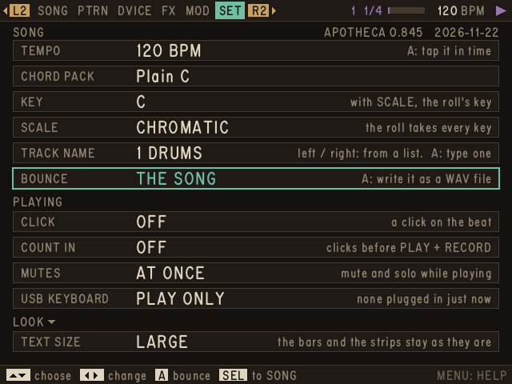

**SET tab, BOUNCE row.** Left / right picks what, A starts it.

| What | Files written |
| --- | --- |
| THE SONG | One WAV of the whole song: every scene as many times as it plays, then **for as long as its echoes and tails take to die away**. Muted tracks are left out. |
| EACH TRACK | One WAV for every track by itself (stems), all the same length (the longest one's), so they line up in any other program |
| THIS TRACK | The track being worked on, by itself |
| MIDI FILE | One MIDI file of the whole song (Type 1): every scene as many times as it plays, one track per track, at the song's tempo. Notes and chords as written, with ratchets and nudges; drums as General MIDI on channel 10. Muted tracks are left out. Chance, swing and feel, strum, glide and automation have no MIDI in them and are left out |

A bounce is **not recorded as the song plays**. A second engine works the
song out again from the start, as fast as the handheld can. So you can
carry on (even play) while it works.

**Where a bounce ends.** After the song's last step it runs on until there has
been no sound for seven seconds, and the file ends half a second after the last
sound. "Sound" is anything a 16-bit file can hold (90 dB under full). So a
dry song ends just after its last drum has rung out, and a long HALL or a
TAPE with its FEEDBACK up is all there, however long it takes. Echoes far
apart (a half note at 40 BPM is three seconds; a REVERSE echo there can come
six seconds after its hit) count as one tail.

There is a cap: **a tail is never longer than eight minutes**. One that would
be is faded out over its last second. No one delay or reverb rings that
long: at its most extreme settings and the slowest tempo (40 BPM) the longest
takes seven minutes to die away (TAPE, PING or DELAY at a half note with
FEEDBACK full), and at 120 BPM a third of that. HALL takes 45 seconds at most, PLATE
52, REVERB 36, SPRING 19. **Two in a row can**: a TAPE with FEEDBACK full in a track's slot feeding
another on the ECHO bus, at 40 BPM, would ring for about twelve minutes, since
the first keeps the second fed. That bounce stops at eight minutes, faded.

If the handheld loses power in the middle of a bounce, the half-written file
is removed the next time Apotheca opens, or the next time a bounce starts.

While it works the row says `WORKING 37%`: how much of the song's own playing
is done. In a tail it says `TAIL 12 S` instead: how many seconds of tail so
far. Nobody knows how long a tail will be until it ends, so there is no
percentage to give.

Files are 48 kHz, 16-bit stereo, in a `bounces` folder beside the program.
The WiFi page lists them under BOUNCES, to play, download or delete.

## Automation

A macro, or a setting of a track's effect, can be **moved by the pattern**.

1. **SELECT + X** turns WRITE on. A red WRITE chip shows in the top bar.
2. Play the song, and move the thing: hold A on a macro (DEVICE) or on an
   effect's setting or a send (FX) and turn it.
3. What you do is written into the cell that is playing, step by step.
   Turn WRITE off (SELECT + X again) and it plays back every time round.

| | |
| --- | --- |
| How fine | One value a step (16 a bar, for every bar of the cell). The setting **glides** to each value over the first half of its step, so a sweep is smooth, not a staircase. |
| Steps with nothing written | The setting rests where its knob is |
| A mark | A purple line under a macro or setting that has automation in the cell being worked on. While it plays, the box shows the value the pattern has it at. |
| Take it away | **B** on the macro, setting or send: back to its middle or default, and its automation in this cell is cleared |
| What can be automated | A synth's eight macros; the four settings of each of a track's three effects; its two sends. Not the master's effects, not what ECHO and SPACE hold, and not the settings on a synth's ADVANCED pages. |
| Undo | SELECT + B takes back a recorded pass like any other edit |

With WRITE off, moving a knob is only moving a knob. Stopped, nothing is
ever written. There is no screen yet for drawing automation step by step:
it is recorded by performing it.

## MOD: a knob that moves by itself

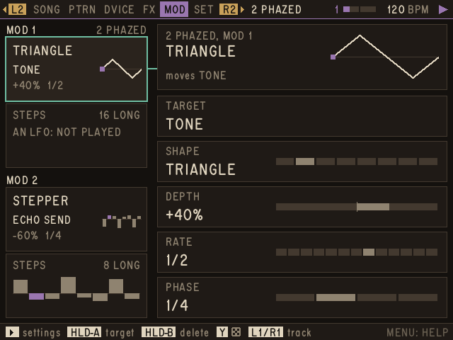

A **MOD** turns a knob up and down by itself, in time with the song. It is
one of two kinds:

| Kind | What it does |
| --- | --- |
| **LFO** | A slow wave: SINE, TRIANGLE, RAMP UP, RAMP DOWN, SQUARE, RANDOM (a new value each cycle) or DRIFT (glides between random values). In time with the song, or **FREE**: at a speed of its own in Hz |
| **STEPPER** | A row of up to 16 values, one held for each note length, round and round |

Each track has **two MODs**. Each one is aimed at one knob: a macro (DEVICE),
a setting of one of the track's effects, a send (FX), or the track's LEVEL or
PAN on the mixer (aimed from the MOD tab). On LEVEL a MOD at 100% swings from
silence to twice the mixer's level; on PAN from the middle it reaches either
side. The mixer still shows its own LEVEL and PAN. A setting that is a
choice (a filter's TYPE, a delay's TIME, Phazed's CHORUS and OCTAVE) takes no MOD.

**Hold X on the knob.** While X is held its MOD shows: on DEVICE where LIVE
OUTPUT was, on FX where the heading was (on SENDS, in the other send's row).
Each button's chip in the bottom bar stands under the field it sets.

| With X held on a knob | Does |
| --- | --- |
| **UP** (no MOD yet) | Makes one: LFO, SINE, 1 BAR, +25% |
| Up / down | DEPTH, 1% a push. The stick turns it smoothly. Below 0% it turns the other way |
| Left / right | RATE: 1/2 STEP up to 8 BARS, then **FREE** (an LFO only), a click a push |
| A | SHAPE: the next wave; after DRIFT, a STEPPER (its row rolled); then SINE again |
| L1 / R1 | An LFO's PHASE (0, 1/4, 1/2, 3/4); a FREE LFO's **SPEED** (a click, next rule); a STEPPER's LENGTH (1 to 16) |
| Y | The dice: a STEPPER's row; an LFO's shape, rate and depth (a FREE one's shape, SPEED and depth, 0.1 to 5 Hz: it stays free) |
| **Hold B** | Deletes the MOD (a second; the strip fills) |

NOW, at the right, shows what the MOD is adding this moment. With the song
stopped, holding X runs the MOD and holds the note, so you hear it. With
both MODs in use on other knobs, the strip says **MODS FULL** and nothing is
made. The knob, or its automation, is the middle the MOD moves around.
WRITE records the knob, never the wobble. Undo (SELECT + B) takes a MOD
back like any other change. A song saves its MODs.

While a MOD runs (the song playing, or X held with it stopped), the knob's own
bar on DEVICE or FX has a **thin brass mark** where the knob is this moment:
the bar shows where the knob rests, the mark where the MOD has it.

**A MOD's DEPTH can change from scene to scene.** Turn DEPTH (on the knob or
on the MOD tab) with WRITE on while the song plays, and it is written into the
pattern, as a knob's turn is. A scene with nothing written uses the MOD's own
DEPTH, so a MOD set to 0% can wobble in one scene only. On the MOD tab a
written DEPTH has the purple line, and while the song plays DEPTH reads what
the pattern says. B on DEPTH puts it back to +25% and empties what was written
in that scene.

**FREE: an LFO that ignores the tempo.** RATE's last choice, after 8 BARS, is
FREE. A free LFO goes at its own **SPEED**, in Hz (cycles a second), from
0.02 Hz (50 seconds a cycle) to 20 Hz. Its PHASE row becomes SPEED, and RATE
reads FREE.

| SPEED | How |
| --- | --- |
| The D-pad (L1 / R1 on the knob, A + up / down on the MOD tab) | A click along 0.02, 0.025, 0.03, 0.04, 0.05, 0.06, 0.08, 0.1 ... 1, 1.2, 1.5, 2, 2.5, 3, 4, 5, 6, 8, 10, 12, 15, 20 Hz (about a third of an octave a click). Between two, it goes to the next |
| The stick, A held, on the MOD tab | Smoothly, any speed between (it reads two figures: 1.3 HZ) |
| B on the MOD tab | 1 Hz |

- It counts **seconds since Play** (or since X went down, stopped), so a tempo
  change does not move it, and Play from the top is the same wobble again.
- A STEPPER has no FREE: its RATE stops at 8 BARS, and an LFO made a STEPPER
  while FREE goes to 1 BAR. Its SPEED is kept for when it is an LFO again.
- **How fast it really moves a knob.** A MOD is worked out 750 times a second
  for an effect's setting, a send, LEVEL and PAN, but only **94 times a second
  for a macro**. So at 20 Hz a macro gets under five values a cycle: a fast
  free LFO on a macro is a coarse staircase, not a wave. On an effect's setting
  or a send it is 37 values a cycle. Nine effects also smooth what a MOD gives
  them over 20 to 30 ms (CHORUS, COMP, DUCK, HALL, PING, PLATE, SATURATE,
  SPRING, TAPE): of a SINE's swing they keep about 72 to 84% at 5 Hz, 46 to
  61% at 10 Hz and 25 to 36% at 20 Hz (measured on the rule, not heard).

### The MOD tab

The tab after FX shows both MODs of the track: a list at the left (MOD 1, its
STEPS, MOD 2, its STEPS), the line picked large at the right, as on FX. A
MOD's line has a small picture of its shape; while the song plays (or X is
held) a dot on it shows where the wave is now, and a STEPPER's row lights
the step playing.

| On the MOD tab | Does |
| --- | --- |
| Up / down, right, left | Move: right goes into the line's settings, left back to the list |
| **Hold A** on TARGET (or on a MOD's line) | The list of targets: MACROS, FX 1 to 3, SENDS, MIXER (LEVEL, PAN), only what a MOD can move. Up / down a line, left / right along it, **let go** to aim it there (a MOD that was off starts as LFO, SINE, 1 BAR, +25%). B with A held: as it was |
| **Hold A** + up / down on a setting | Turns it: DEPTH 1% a push, a step or SLEW or CHANCE 5%; SHAPE, RATE, PHASE and LENGTH a click; a FREE LFO's SPEED a click of its list. The stick turns the amounts (and SPEED) smoothly |
| **Hold A** + left / right on the row | The step before / after, still holding A: a whole row in one grip |
| B | A setting back to its usual (DEPTH +25%, SHAPE SINE, RATE 1 BAR, SPEED 1 Hz, a step 0...) |
| **Hold B** on a MOD's line | Deletes the MOD (a second; undo brings it back) |
| Y | The dice: on a MOD's line as on the knob; on STEPS, the row |
| X | Hear the track. Held on a MOD's line with the song stopped, that MOD runs |
| L1 / R1 | The track before / after |

A MOD's settings: TARGET, SHAPE (SINE ... DRIFT, then STEPPER), DEPTH, RATE,
and PHASE (an LFO), SPEED (an LFO at RATE FREE) or LENGTH (a STEPPER). Its STEPS: the row of 16 (steps past
LENGTH are faint), then LENGTH, **SLEW** (how much of a step it takes to glide
to the next value) and **CHANCE** (how often a step plays a fresh random value
instead of the one written). An LFO keeps a row too, for when it becomes a
STEPPER.

## FM-6

**Six-operator FM, after a classic 80s synth.** FM is sine waves
("operators") bending each other's pitch very fast. An operator that is heard
is a carrier; one that only bends another is a modulator. Which bends which is
the ALGORITHM, one of 32 wirings. Each operator has its own envelope, tuning
and level.

- **160 presets in five folders, ROM 1A, 1B, 2B, 3B and 4B**: five factory
  banks of the synth it is modeled after, each in its order (ROM 1A is the
  first cartridge, BRASS 1 ... TAKE OFF), names as the cartridges write them
  with their gaps closed up. A new FM-6 track starts on the first. Some names
  are in two banks, and eight voices are copies of one before them (kept so
  each bank is whole: `tools/fm6/README.md`).
- **73 more in twelve folders of their own, each a whole track sound** (the
  synth with its effects, sends and MODs, picked as one): **KEYS** (7: electric
  pianos, a clav through a wah, a worn celeste, vibes), **BASS** (6), **BELLS &
  METAL** (6), **PADS** (6), **LEADS** (6), **PLUCKS** (6), **FX & ATMOS** (6) and
  **MOVING** (6: a MOD is most of the sound); then 24 more, factory voices
  given a room: **ORGANS**, **BRASS**, **DRONES** and **ARPS** (6 each). Some are factory voices dressed up,
  some are new voices. Nobody has heard them yet: their levels, peaks and tails
  are measured, and each MOD is checked to change the sound. The ten to try first:

  | Preset | What it is |
  | --- | --- |
  | KEYS / Suitcase | the tine piano in its amp, panning side to side |
  | KEYS / Glass Tines | a new piano: two bodies drifting in and out of tune, a glass layer |
  | BASS / Growl | a rough saw through a low-pass that wobbles |
  | BASS / Acid FM | an acid line: its accents and lengths step on two different counts |
  | BELLS & METAL / Shimmer Bells | tubular bells into a SHIMMER that swells |
  | BELLS & METAL / Chime Cluster | five out-of-tune chimes beating, each again backwards |
  | PADS / Glass Pad | slow glass, its brightness and place drifting |
  | LEADS / Talk Box | a lead that says a different vowel every eighth |
  | FX & ATMOS / Wind Organ | a pipe with wind in it, sung through a vowel, in gusts |
  | MOVING / Feedback Tide | three saws, one torn by FEEDBACK and smoothed again |

  Every one, with what makes it and its figures: `docs/plans/fm6-plan.md`, section 11.
- **Every one of the original's 145 voice settings is there**, by its own
  number, so a sound from any bank of the original goes in setting for
  setting. Not played: pitch bend, the mod wheel, breath and foot.
- **Sixteen voices.** A voice costs only while it sounds.
- **Built on msfa**, the FM core of Google's music-synthesizer-for-android
  (Apache 2.0; its licence ships with the program). The plan, the choices and
  what each preset measures: `docs/plans/fm6-plan.md`.

The macros. Each at +0 is the patch as it is; a preset puts all eight back.

| Macro | Down | Up |
| --- | --- | --- |
| BRIGHT | The modulators quieter, to none: plain sines | Up to 12 dB more: harsher |
| FEEDBACK | The patch's feedback, to none | Up to 7, smoothly |
| ATTACK | Every operator's first rate faster | Slower |
| DECAY | The middle of the envelopes shorter | Longer |
| RELEASE | Shorter after the key is let go | Longer |
| DETUNE | The patch's own detune taken out: all in tune | The operators spread apart, up to 20 cents |
| LFO | The LFO's depths to none | To full (where the patch lets the LFO in) |
| PITCH ENV | The pitch envelope's depth to none | To twice |

FEEDBACK up does nothing on a patch already at 7 (18 of the 32), and LFO up
does nothing where the patch has no LFO sensitivity.

ADVANCED is eight pages. L1 and R1 turn them.

| Page | Holds |
| --- | --- |
| VOICE AND LFO | ALGORITHM (1 to 32), FEEDBACK, TRANSPOSE (in semitones), KEY SYNC; LFO WAVE, SPEED, DELAY, SYNC; PITCH DEPTH, LEVEL DEPTH (the LFO's), PITCH SENS |
| OPERATOR 1 to 6 | One page each, all of it: **ON**, OUTPUT LEVEL, COARSE, FINE; MODE, DETUNE, VELOCITY, LEVEL SENS (how much the LFO moves its level); RATE 1 to 4 over LEVEL 1 to 4 (its envelope: each rate is how fast it goes to the level under it); RATE SCALING, BREAK POINT, LEFT and RIGHT DEPTH, LEFT and RIGHT CURVE (how its level follows the keys) |
| PITCH ENVELOPE | RATE 1 to 4 over LEVEL 1 to 4 (50 is the key's own pitch) |

- **ON turns an operator off** without touching its settings: the quick way
  to hear what each one adds.
- **COARSE and FINE read as what they make.** With MODE at RATIO, COARSE is
  the ratio to the key (0.50, 1.00, 2.00 ...) and FINE the whole ratio with
  it (1.41). With MODE at FIXED the operator plays one pitch whatever the key:
  COARSE reads 1, 10, 100 or 1000 HZ and FINE the pitch (324 HZ).
- **BREAK POINT reads as a key** (C3 is where the original's middle is),
  DETUNE -7 to +7, the curves -LIN, -EXP, +EXP, +LIN.
- A setting is heard from the next key played; the LFO's SPEED, DELAY and
  WAVE and the macros at once.
- The operator pages have six rows, so they stand a little closer than other
  pages. At XL their boxes are drawn at LARGE: XL's value would stand on its
  bar.

**Not heard on the handheld yet**, and not run there: the tests and the stills
have seen it. Its estimated cost there is about 6 to 10% of one core for eight
notes (QMOD's was 57%).

## PHYSIC

**Plucked and struck sounds that ring by themselves**: strings, marimba,
vibes, glockenspiel, kalimba, bells, glass, drums, wood. It copies how real
things ring, not how oscillators sound. A note is a **strike**: a mallet or a
pluck on an object (the MODEL), which then rings and dies away. There is no
volume envelope: DECAY is how long the object rings, and letting go of the key
damps it (RELEASE; at RING letting go does nothing, as a marimba has no damper).

- **32 presets in six folders**: MALLETS (Marimba, Soft Marimba, Xylophone,
  Vibes Still, Glockenspiel, Vibes, Celesta), STRINGS (Steel, Harp, Koto, Pizz,
  Plucked Bass, Nylon, Dulcimer, Twelve, Plucked Bass Box), TINES (Music Box,
  Kalimba), BELLS (Church Bell, Handbell, Tubular Bell, Wine Glass, Crystal),
  WOOD AND SKIN (Woodblock, Temple Blocks, Log Drum, Tom, Hand Drum) and DICE
  (Rain, Wind Chime, Loose Strings, Drunk Marimba). **A new PHYSIC track
  starts on Marimba**, so notes placed at once play a marimba line. After
  them, presets that hold a track sound (effects, sends, MODs: "Presets"
  above), in folders of their own: SHIMMER (Glass Steps, a bell through
  SHIMMER with a STEPPER on POSITION), then **79 more in ten folders**:
  ATMOS (glass drawn by a breath, a singing bowl, pads that swell and beat),
  METAL (gongs, an anvil, a steel pan, a comb, a ring modulator), GAMELAN
  (bronze in pairs that beat), PREPARED (strings with bolts, paper, clips,
  felt and tacks), PERCUSSION (a brush snare, a hand pan, udu, tabla, a
  rattle), PLUCKS (strings and tines through ensemble, dub, phaser, flanger,
  bloom), TEXTURES (worn, crushed, fuzzed, backwards) and MOVING (a MOD is
  most of the sound: a STEPPER walking where a marimba is struck, wood
  turning to metal while it rings), then BASS and KEYS (eight each: plucked,
  struck and buzzing basses; struck strings, tines and bars played as keys).
  Ten to try first: Bowed Glass, Singing
  Bowl, Gong Wash, Ombak, Bolt Piano, Hand Pan, Dub Kalimba, Jawari, Timbre
  Walk, Wood To Metal. Nobody has heard them yet; each was measured to play
  at a sane level, not clip, end its tail and move its MODs
  (`docs/plans/physic-plan.md`, section 17).
- **Eight voices.** A voice costs only while it rings. A key struck again
  while it rings is the same voice: on a bar or a bell the new hit adds to the
  ringing (a ratchet is a real roll); a string is damped for 2 ms first, as a
  plectrum meets it.
- **GLIDE on a ringing note bends it** without a new strike (a slide guitar),
  when it is the only note of its moment gliding from that key.
- **Stop lets the notes go** (RELEASE damps, RING rings on), so a bounce keeps
  the last bar's bells ringing. Play and the panic damp everything at once.
- **Y on MAIN rolls a new sound**: a new STRIKE, HARDNESS, POSITION, DECAY,
  MATERIAL and STRETCH on the same MODEL, and now and then PAIR, MOTOR and
  BUZZ (BODY MIX too). Its BODY, levels and dice stay. It is a step of undo.
- The plan, the sources of each figure and what was measured:
  `docs/plans/physic-plan.md`.

The macros. Each at +0 is the patch as it is; a preset puts all eight back.
Below the middle a macro slides its setting down to the least, above it up to
the most.

| Macro | Moves | Heard |
| --- | --- | --- |
| TONE | HARDNESS | At the next strike |
| POSITION | POSITION | At the next strike |
| DECAY | DECAY | At once, on ringing notes too |
| MATERIAL | MATERIAL | At once: wood to metal in one sweep |
| STRETCH | STRETCH | At once: ringing notes retune |
| RELEASE | RELEASE | At the next let go |
| DICE | DICE | At the next strike |
| OCTAVE | DOWN / AS PRESET / UP | At the next note. A choice, so it takes no MOD |

ADVANCED is five pages. L1 and R1 turn them.

| Page | Setting | Reads |
| --- | --- | --- |
| SOUND | MODEL | STRING, MARIMBA, XYLO, VIBES, GLOCK, KALIMBA, BELL, CHIME, GLASS, DRUM, WOOD |
| | STRIKE | PLUCK, MALLET or NOISE (a burst of noise: a breath, a bow on glass, a brush) |
| | HARDNESS | With a MALLET, how long it touches: 8.0 MS (yarn) to 0.30 MS (brass), at full velocity. Plucked, finger (0%) to plectrum (100%). With NOISE, how long the burst lasts: 2.0 S to 2 MS |
| | POSITION | Where along it is struck: 1.0% to 50% (the middle), "1/5" where it is the setting nearest a fifth. It decides which parts of the sound wake: a bar struck in its middle has no second part |
| RING | DECAY | 50 MS to 30 S: the longest it rings |
| | MATERIAL | WOOD to METAL. On METAL every part rings for DECAY; toward WOOD the high parts, and high keys, die sooner |
| | STRETCH | AS MADE at the middle: the object's own partials. Below, toward whole-number partials; above, further apart. On a STRING it is the string's stiffness, B (B 0.0005: a piano's high partials are sharp) |
| | RELEASE | 10 MS to 2.8 S after letting go, then RING |
| PLAY | VELOCITY | How much a note's velocity moves its level and its mallet (OFF: every note full) |
| | OCTAVE, FINE | -2 to +2; -50 to +50 CENTS |
| | WIDTH | Low keys left, high keys right, as a marimba stands |
| | LEVEL | -24 to +6 DB |
| DICE | DICE | How much the four below are used: each note struck a little off where, how hard, how in tune and how long the last was |
| | DICE POSITION, DICE HARDNESS | At 100: up to 25 and 30 points either way |
| | DICE TUNE | Up to 15.0 CENTS either way |
| | DICE DECAY | At 100: the time up to 30% longer or shorter |
| BODY | PAIR | OFF, or 1 to 20 CENTS: each note two of it, that far apart, so they beat (a twelve-string, a piano's or a dulcimer's course, a bell's warble). On a string, a second string; on the rest, the two lowest parts each doubled. 20 cents at middle C beats 3 times a second |
| | MOTOR | OFF, or a tremolo of 0.20 HZ (a slow swell) to 8.0 HZ, as a vibraphone's motor. It starts with each note |
| | BODY | NONE, GUITAR, BOX or TUBES. GUITAR and BOX are what the sound sits on: their low resonances (near 100, 200 and 400 Hz; 180 and 420 Hz) added to every note. TUBES is a marimba's tubes: the note's own part rings louder and three times as long |
| | BODY MIX | How much of the BODY: at 100% a resonance is twice as loud |
| | BUZZ | OFF, or loose parts that rattle while the note is loud (an mbira's bottle caps, a snare's wires): for the top 6 DB to 36 DB of its ring |

- The dice are rolled from where and when a note is struck, so Play twice is
  the same performance, and each time round the loop rolls anew.
- HARDNESS and POSITION act at the next strike, as on a real instrument;
  DECAY, MATERIAL and STRETCH on notes already ringing. PAIR and TUBES are
  how the object is made: they act at the next strike. MOTOR, BUZZ and the
  GUITAR and BOX bodies act at once.
- On the designer page STRETCH reads as on a bar (AS MADE, +20): the string's
  B is the handheld's reading only.

**Nobody has heard it**, on the desk or the handheld: the tests and the stills
have seen it, and every claim about its sound is a measurement. Its cost on
the desk is 0.2 to 0.6% of one core for eight notes, about 0.4 to 0.6% with
every BODY page setting on (0.8% with every note gliding as well); the
handheld is about 13 to 17 times slower (not run there).

## ACID

**A one-voice bass in the style of the classic bass line box**: one
oscillator (SAW or SQUARE), a resonant four-pole filter, a filter decay and an
amp decay, ACCENT and SLIDE. Nothing new to learn on the roll: an accent is a
note at 100%, a slide is a note's GLIDE.

- **ACCENT is a note at 95% or more.** A note is placed at 90%, so it is plain;
  hold A + RIGHT once (90% to 100%) and it is accented: louder, its filter
  decay the shortest (0.2 S), and the cutoff swept up. Accents close together
  climb higher (the SWEEP): four accents a sixteenth apart open the filter
  further each time; a second apart, each is the same. On an ACID track an
  accented note wears a small brass corner at its top right. A keyboard's hard
  hit (121 of 127) accents. At ACCENT 0 an accent is a plain note.
- **SLIDE is a note's GLIDE** (hold X + UP on the note: 1/4, then 1/2 a step,
  and longer). A gliding note slides in pitch from the note before and **does
  not start the envelopes again**: it ties. It ties when the note before is
  still held or ended under a step ago, so a note shorter than its step still
  ties into the slide after it; with an empty step between, the slide starts
  the envelopes again. **A GLIDE to the same key is a tie: one long note.** The
  slide takes the glide's own length (the roll's line), or 60 MS at SLIDE FIXED.
- **One voice**: the newest note wins, and letting it go never goes back to a
  note still held. In a chord the last key to start sounds.
- **64 presets in nine folders**: CLASSIC (Classic Saw, Classic Square,
  Rubber Saw, Hollow Square, Echo Line, Low Pulse, Echo Square, Bright
  Classic), SQUELCH (resonance up, short decays: Squelch, Rubber Duck, Wet
  Snap, Screamer, and four with a STEPPER walking the cutoff: Step Squelch,
  Gurgle Steps, Chance Squelch, Long Squelch), DEEP (an octave down, little
  envelope: Sub Line, Deep Square, Warm Floor, Dark Round, Low Murmur, Velvet
  Bass), DISTORTED (each with DRIVE, SATURATE or FUZZ in its first slot:
  Driven, Saturated, Fuzz Line, Tube Acid, Burnt Rubber, Dub Smash) and MOVING
  (a MOD plays the knob: Breathing, Wobble Reso, Semitone Steps, Drift), then
  CLEAN (round lines, little resonance), LEADS (an octave up, through an
  echo, a ring, a flanger or a vowel), DUB (into the delays and the rooms) and
  HARD (folded, crushed, clipped, fuzzed), eight each. **A
  new ACID track starts on Classic Saw.** Ten to try first: Rubber Saw, Echo
  Line, Squelch, Wet Snap, Step Squelch, Long Squelch, Sub Line, Burnt Rubber,
  Dub Smash, Drift. Each was measured playing a 16-step acid line: a sane
  level, nothing into the synth's clip (placed or accented), tails that end,
  MODs that move and are heard.
- **Y on MAIN does nothing** (no dice for this one).

The macros. Each at +0 is the patch as it is; a preset puts all eight back.
Below the middle a macro slides its setting down to the least, above it up to
the most. None is a choice, so each takes a MOD (hold X on it).

| Macro | Moves |
| --- | --- |
| CUTOFF | CUTOFF |
| RESO | RESONANCE |
| ENV MOD | ENV MOD |
| DECAY | DECAY |
| ACCENT | ACCENT |
| DRIVE | DRIVE |
| SWEEP | SWEEP |
| TUNE | TUNE: a STEPPER on it is a line of semitones up and down |

ADVANCED is two pages. L1 and R1 turn them.

| Page | Setting | Reads |
| --- | --- | --- |
| SOUND | WAVE | SAW or SQUARE |
| | OCTAVE | -2 to +1 |
| | TUNE | -100 to +100 CENTS |
| | LEVEL | -24 to +6 DB |
| | VELOCITY | OFF: every plain note one level, as the original. ON: a plain note's level is its velocity |
| | SLIDE | NOTE (the glide's own length) or 60 MS |
| FILTER | CUTOFF | 50 HZ to 6400 HZ: the pitch the filter sings at, with no envelope |
| | RESONANCE | 0% to 100%. From 95% it sings by itself, at the CUTOFF's pitch |
| | ENV MOD | How far the filter decay opens the cutoff: up to 5 octaves |
| | DECAY | 200 MS to 2.0 S, the filter decay's fall to a tenth. An accent always takes the shortest |
| | ACCENT | OFF, or how much an accent does: up to 8 DB louder and 2.5 octaves of sweep |
| | SWEEP | How far accents close together climb. 0: each accent the same |
| | DRIVE | OFF, or into the filter's soft clip: up to 8 times. Heavy dirt is the FX screen's |
| | AMP DECAY | 200 MS to 6.0 S, the amp's fall to a tenth while the note is held |

- **Writing a line on the handheld**: A places a note (keep A held and press
  RIGHT once for an accent); hold X and press UP twice for a slide of half a
  step. A 16-step line with four accents and four slides was 165 presses, most
  of them walking between keys: the stick is quicker for the big leaps.
- Turning RESONANCE up makes the sound louder: the squelchy presets carry
  their LEVEL down for it.

**Nobody has heard it**, on the desk or the handheld: the tests and the stills
have seen it, and every claim about its sound is a measurement against the
plan's own guesses (no recording of the original was measured). Its cost on the
desk is about 0.13% of one core for a busy line; the handheld is about 13 to
17 times slower (not run there). The plan: `docs/plans/acid-plan.md`.

## CLOUD

**Clouds of grains from your recordings.** A grain is a short piece of a
recording (5 MS to 1 S) with a soft fade in and out. A key held on CLOUD plays
many of them at once, each from a slightly different place, at the key's
pitch: a drum loop becomes a hum, a voice a choir, a chord a pad. With no
recording it plays a built-in TONE (a soft note about middle C), so a new
track makes a sound at once.

- **Pick its recording on SOURCE, the first page**: the first stop is
  RECORDING. A opens the list of recordings (the same list as the sampler's:
  folders, a preview as you go, X to hear); **hold A + UP / DOWN** steps to the
  next one, heard at once. **R1 there records** a new one (as the sampler's
  R1; elsewhere R1 turns the page). **Y on SOURCE is CATCH**: the last bar the
  song played becomes this track's recording. B in the list leaves the
  recording as it was. "THE BUILT-IN TONE" at the top of the list is none.
- **MAIN shows the recording**, between PRESET and the macros: its outline,
  the part the grains come from lit (POSITION give or take SPRAY), POSITION a
  brass line, and a teal tick at the top and bottom for each grain sounding.
  The recording has no ends: a grain that runs past one comes in from the
  other, and the lit part goes round too.
- **Six keys sound at once.** A seventh lets go of the oldest key already let
  go, else the oldest. The same key struck again keeps its grains going.
  At most 24 grains sound in the track at once (12 a key); past that the cloud
  thins, it never clicks. STOP lets keys ring out under their RELEASE; PLAY
  and the panic fade them in 5 MS.
- **Every grain's place, pitch, side and direction is a roll by where and
  when** (the key's start and the grain's count), not dice thrown as it plays:
  Play from the top is the same cloud again, and a bounce is what you heard.
- **Y on MAIN rolls a new cloud**: SPRAY, SIZE, DENSITY, SCATTER, SHAPE, PITCH
  SPRAY, PITCH STEPS, REVERSE and STEREO. It never changes the recording,
  POSITION, SCAN, PITCH, TUNE, the envelope or the levels. One step of undo.
- **48 presets in eight folders**: STILL (one place, held: Soft Cloud, Glass
  Hold, Breath Pad, Frozen Shimmer, Still Water, Halo), DRIFT (the place moves:
  Slow Tide, Backwards River, Wander, Tape Scrub, Drifting Choir, Pendulum),
  DUST (short grains, sparse: Dust, Crackle, Rain on Glass, Embers, Static
  Specks, Step Dust) and CHOIR (pitched on octaves and fifths: Fifths Choir,
  Octave Ghosts, Cathedral, Low Choir, Bloom Choir, Choir Sweep), then PADS,
  DRONES, PLUCKS and RHYTHM (in time with the song: a STEPPER or an effect
  plays it), six each. **A new
  CLOUD track starts on Soft Cloud, on the TONE.** Thirteen carry a MOD, 23 an
  effect or a send. A preset picked keeps the track's recording; **a preset of
  your own saved on CLOUD keeps its recording's name**, and picked again puts
  that recording back (by its name, else the one recording of the same name in
  another folder, else it says RECORDING NOT FOUND and keeps the track's).

The macros. Each at +0 is the patch as it is; a preset puts all eight back.
Below the middle a macro slides its setting down to the least, above it up to
the most. None is a choice, so each takes a MOD (hold X on it).

| Macro | Moves |
| --- | --- |
| POSITION | where in the recording the grains come from |
| SPRAY | how far each grain's place is scattered about it |
| SIZE | each grain's length |
| DENSITY | grains a second |
| SCAN | the place moving on by itself, forwards or back |
| PITCH | PITCH SPRAY |
| SHAPE | each grain's fade: PLUCK, SMOOTH, SWELL |
| REVERSE | the share of grains played backwards |

ADVANCED is three pages. L1 and R1 turn them.

| Page | Setting | Reads |
| --- | --- | --- |
| SOURCE | RECORDING | its name, TONE, or NOT FOUND (the TONE plays) |
| | POSITION | 0% to 100% of the way into the recording |
| | SPRAY | OFF to +-50%: how far a grain's place is rolled, as a share of the recording |
| | SCAN | -2.00X to +2.00X: the place moves on at that speed (+1.00X is the speed it was made); FREEZE in the middle |
| | PITCH | semitones up or down, **up is higher**; 0 plays the recording at its own pitch at middle C (it was ROOT, a key, which ran the other way) |
| | TUNE | -100 to +100 CENTS |
| GRAINS | SIZE | 5.0 MS to 1.00 S |
| | DENSITY | 1.00 HZ to 200 HZ, grains a second for each key |
| | SCATTER | 0%: grains evenly spaced; 100%: at random times (the same number a second) |
| | SHAPE | PLUCK (a fast rise), SMOOTH, SWELL (a slow rise) |
| | REVERSE | OFF, or the chance a grain plays backwards |
| | STEREO | how far each grain is placed left or right |
| PLAY | PITCH SPRAY | OFF to +-1200 CENTS: how far each grain's pitch is rolled |
| | PITCH STEPS | FREE, OCTAVES or FIFTHS: the rolled pitch held to that grid |
| | ATTACK | 1.0 MS to 8.0 S |
| | RELEASE | 2.0 MS to 20.0 S, after the key is let go |
| | LEVEL | -40.0 DB to 0.00 DB, OFF at 0 |
| | VELOCITY | OFF: every key one level; 100%: a key's level is its velocity |

- The cloud keeps about one level at any DENSITY and SIZE (more grains, each
  quieter).
- Every click of the D-pad reads another way: the readings carry as many
  figures as it takes (SPRAY 1 reads +-0.005%).

**Nobody has heard it**, on the desk or the handheld: the tests and the stills
have seen it, and every figure is the plan's own choice. Its cost on the desk:
one key about 0.05% of one core, the 24 grains all sounding about 0.55%; the
handheld is about 13 to 17 times slower (not run there). The plan:
`docs/plans/granular-plan.md`.

## MORPH

**Wavetables, swept from wave to wave.** A table is 32 single waves (FRAMES)
in a row: a sine growing into a saw, a pulse narrowing, a vowel changing.
POSITION picks where in the row a key reads, and between two frames it hears
both, crossfaded. Turn POSITION, or let the MOD ENV or a MOD move it, and the
sound walks through the table while the note plays.

- **Two oscillators, A and B**, each on its own table and POSITION; MIX
  crossfades them. B can be tuned against A (B SEMI, B FINE) or be OFF. A
  SUB, a sine an octave under A, sits under both.
- **16 built-in tables**: ANALOG, PULSE, SYNC, VOWEL, ORGAN, HARMONIC, FOLD,
  BEND, FM, RATIO, DRIVE, STEPS, GRIT, COMB, BELL, GLASS. They are made when
  the program starts (about a fifth of a second on a desk).
- **MAIN shows the waves**, between PRESET and the macros: A's wave in teal,
  B's in purple behind it, and under them a strip of the 32 frames with
  POSITION A in brass. While a key sounds, the wave is the one the newest key
  reads, so you see the MOD ENV or a MOD moving it.
- **UNISON** stacks up to four copies of each oscillator, spread by DETUNE and
  WIDTH. Six keys sound at once, fewer with UNISON up: the box says how many
  ("2, 6 KEYS"; "4, 3 KEYS" with B on).
- **A filter** (OFF, LOW 12, LOW 24, BAND, HIGH) with CUTOFF, RESONANCE and
  KEY TRACK, an AMP envelope, and a MOD ENV that moves POSITION (both tables)
  and CUTOFF.
- **Y on MAIN rolls a new sound**: both tables and POSITIONs, MIX, B's tuning,
  SUB, UNISON, DETUNE, WIDTH, the filter, the MOD ENV and its two amounts.
  OCTAVE, TUNE, the AMP envelope, KEY TRACK, VELOCITY and LEVEL stay. One step
  of undo.
- **64 presets in eleven folders**: BASIC (one table each, played plainly: Analog
  Sweep, Pulse Width, Sync Rise, Vowel Talk, Organ Stops, Harmonic Walk, Fold
  Grow, FM Bell), PADS, LEADS, BASS and MOVING (a MOD on POSITION in each: a
  table played as a sequence of waves, a free LFO, a step with chance), then
  KEYS, PLUCKS (six each), BELLS, ARPS, DRONES and FX (five each). **A new
  MORPH track starts on Analog Sweep.** Seventeen carry a MOD, 33 an effect or
  a send.
- **On the WiFi page** the TABLES section draws A's and B's: every frame of the
  table stacked, the one POSITION reads bright. Click or drag to move POSITION.

The macros. Each at +0 is the patch as it is; a preset puts all eight back.
None is a choice, so each takes a MOD (hold X on it).

| Macro | Moves |
| --- | --- |
| POSITION | A's and B's POSITION together |
| MIX | A against B |
| CUTOFF | the filter's cutoff |
| RESO | its resonance |
| ENV POS | how far the MOD ENV moves POSITION |
| ENV CUT | how far the MOD ENV moves CUTOFF |
| DETUNE | the unison's spread |
| RELEASE | the AMP envelope's release |

ADVANCED is five pages. L1 and R1 turn them.

| Page | Setting | Reads |
| --- | --- | --- |
| OSC | TABLE A | the table's name |
| | POSITION A | FRAME 1.00 to FRAME 32.00 |
| | TABLE B | OFF, or the table's name |
| | POSITION B | FRAME 1.00 to FRAME 32.00 |
| | MIX | A ONLY, A 50 / B 50, B ONLY |
| | B SEMI | -24 to +24 ST |
| | B FINE | -50 to +50 CENTS |
| | SUB | OFF, or its level in DB |
| VOICE | OCTAVE | -2 to +2 |
| | TUNE | -100 to +100 CENTS |
| | UNISON | 1 to 4, and the keys that leaves |
| | DETUNE | OFF to +-50.0 CENTS (the outer copies) |
| | WIDTH | 0% (all in the middle) to 100% (spread to both sides) |
| | VELOCITY | OFF: every key one level; 100%: a key's level is its velocity |
| | LEVEL | -24 to +6 DB |
| FILTER | FILTER | OFF, LOW 12, LOW 24, BAND, HIGH |
| | CUTOFF | 20 HZ to 20.0 KHZ |
| | RESONANCE | 0% to 100% |
| | KEY TRACK | 0%: the cutoff stays put; 100%: it follows the key an octave an octave |
| AMP | ATTACK, DECAY, SUSTAIN, RELEASE | the envelope below |
| ENV | ATTACK, DECAY, SUSTAIN, RELEASE | the MOD ENV, the same scale |
| | > POSITION | OFF, or +- up to 31 FRAMES at the envelope's top |
| | > CUTOFF | OFF, or +- up to 6 OCT at the envelope's top |

**Nobody has heard it**, on the desk or the handheld: the tests and the stills
have seen it. The handheld makes the same tables and the same sound to the
bit (tested under an emulator with its build, not on the device). Its cost on
the desk: six keys about 0.5% of one core, every stream sounding about 0.7%;
the handheld is about 13 to 17 times slower (not run there). The plan:
`docs/plans/wavetable-plan.md`.

## The envelope

The sampler has one volume envelope (and any synth added later can use
it), so a setting means the same wherever it is:

| Setting | 0 | 50 | 100 |
| --- | --- | --- | --- |
| ATTACK | 1 ms | 89 ms | 8 s |
| DECAY, RELEASE | 2 ms | 200 ms | 20 s |

The attack is curved like an analog one: most of the rise comes early, so a
short attack is snappy, and it starts from wherever the envelope already is,
so a note played again does not click. Decay and release times are how long
the sound takes to fall by 60 dB. Phazed keeps its own eight-step envelopes,
and JAX-EP its own one (ATTACK, DECAY, SUSTAIN, RELEASE as dials; its times
are guesses, as MAIN says there: SPEEDS GUESSED).

## All four cores

The tracks do not depend on each other until they are mixed, so they are
worked out side by side: the audio thread and two helpers each take the next
track not yet done, and the results are mixed in track order. The busiest
song the SPEED TEST knows (twelve tracks: six of drums, two each of JAX-EP,
FM-6 and PHAZED playing strummed chords and arpeggios, every hit and chord
thrown, three effects on every track, both buses, two on the master) took
about 20% of the time it had on one core of the build machine and about 13%
with two helpers (2026-11-15, with QMOD where FM-6 is now; not yet run on the
handheld). The sound is the
same to the last bit, and a test holds it to that. One core is left for the
screen. Bounces use it too.

No synth has a quality setting, so nothing is turned down when the handheld
is busy: a song that is too much for it stutters, and SPEED TEST on the WiFi
page says how near a song of that size comes.

## A USB keyboard

Plug a MIDI keyboard into the handheld's USB-C socket (through an adapter
if its plug is the big kind). Nothing to set up: Apotheca looks for one a
few times a second, and SETUP's USB KEYBOARD row says when it has found one.

- **It plays the track being worked on.** A synth track: the keys. A drum
  track: C2 upward is the eight drums, lane 1 first, round again every eight
  keys. How hard a key is hit is how loud.
- **On the piano roll the cursor goes to the last key played**, so A places
  a note there.
- **PLAY + RECORD:** while the song plays, what is played is also written
  into the cell that is playing: on the step it was played in, as long as
  it was held (whole steps, to the end of the bar at most).

The keys are read on a thread of their own and go straight to the sound, so
a note does not wait for the screen. Not tested on a real keyboard yet: the
tests use made-up ones. The handheld's log (`device-info.log`) lists any
MIDI device it sees.

## SONG

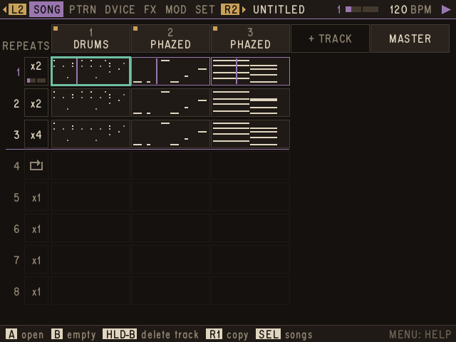

The track columns share the width of the screen: with few tracks they are wide.

| On | A | Hold A + stick | B | Hold R1 and drag |
| --- | --- | --- | --- | --- |
| A cell | Opens it on PATTERN | Left / right: how long it is (1, 2, 4 or 8 bars). **Up / down: TRANSPOSE** its notes and chords a semitone (the stick up / down: an octave), every bar of it; the box above the bar says how far (MOVED +3 SEMITONES). A drum cell does not move. If a key would pass C0 or C8 nothing moves (NO ROOM). One step of undo | Empties it | **R1** copies it; **R1** on another cell pastes it there, on its let go, and the copy is cleared. Notes go on notes (any synth or sampler) and drums on drums (NO PASTE: OTHER KIND; the copy is kept for elsewhere). **R1** on it again clears the copy without pasting. One step of undo |
| A track's head (up from the top scene, with the D-pad) | **A** (a quick tap) changes its instrument: its notes, name and effects stay, and it starts on the new instrument's first sound. Its old sound and its knob moves go (the list warns UNSAVED PATCHES WILL BE LOST). This cannot be undone. Held, it is the mixer: once its card is up, letting go never changes it, turned or not. While it is held the head fills with the level, as a lane's name does. **R1**, on its let go, types its name. **Hold L1 and press R1** copies the track: a new track right after it with the same instrument, sound, effects, sends, MODs, mixer, name and every scene's patterns (the tracks after it move a place along; twelve is the most). The copy is not soloed. It is not undone by SELECT + B: hold B on the copy deletes it. **Hold B** two seconds deletes the track. Y and X work there as on its cells. | | | |
| A track (any of its cells) | **Y** mutes it and **X** solos it, each a tap, at once, playing or not; again to undo. X does not hear the track here: on its DEVICE page it does. L1 does nothing on a track. A muted track's head shows M, a soloed one S. The song keeps mutes, not solos. | | | |
| A track | **Hold B for two seconds: delete the whole track.** (A tap of B only empties the cell.) After half a second its head starts to fill red and the bar at the bottom says it cannot be undone; let go before it is full and nothing is deleted. The tracks after it move down. This cannot be undone, and the last track cannot be deleted. | | | |
| A repeat count | Tap: 1, 2, 4, 8. **R1** copies the whole scene; **R1** on another row pastes it there, on its let go, and the copy is cleared | Times the scene plays, 1 to 16 | Back to 1; held, empties the whole scene (one step of undo) | |
| The song's end (the REPEATS box of the first empty row, just past the last scene) | Switches what the song does at its end: LOOP (a loop arrow) or STOP (a square) | | Back to LOOP | |
| + TRACK | Pick DRUMS, PHAZED, JAX-EP, SAMPLER, FM-6, PHYSIC, ACID, CLOUD or MORPH | | | |
| MASTER (the head at the right-hand end, right of + TRACK) | | Its level and pan, as a track's (below) | | |

The song runs to the last scene with anything in it. Then, by its **song end**:

- **LOOP** (the usual): it comes round to the first scene, for good.
- **STOP**: it stops on the step after the last scene's last step: notes let go,
  echoes and tails ring out (a stop by hand instead fades sounding samples
  fast). The next START
  plays from the scene you are on, as always. Catch (Y) after it gives the
  song's last bar.

The song end is kept with the song and undone like any edit. It is for the
song only: a scene played alone (START on PATTERN) goes round as before, and
a bounce plays the song once whatever it says. With all 16 rows holding
scenes there is no empty row, so no place to change it.

### The mixer: a track's LEVEL and PAN

On a track's head, or on MASTER, **hold A**. A card comes up under the head
with the level and the pan, in words and as two bars.

| With A held | Does |
| --- | --- |
| UP / DOWN | LEVEL, one dB a press, from -40 DB to +6 DB. 0 DB is the level a track always had. Held, it runs on. |
| LEFT / RIGHT | PAN, one step a press, from L 50 to R 50. MIDDLE is the usual. |
| The stick | The same, in big moves. |
| B | Back to the usual: 0 DB and MIDDLE. (B on a head without A still only deletes, held.) |
| START | Plays and stops, as always. Y, X and L1 do nothing while A is held, so a track is not muted or soloed by mistake. |

- Pressing A while a track is being deleted (B held, its head filling)
  stops the delete. So does it on a cell.
- **A head not at its usual level or pan has a small brass square** in its
  top left corner, so a changed track can be seen at a glance.
- PAN keeps the loudness even as it moves (equal power): hard to one side,
  that side is 3 dB up and the other silent. In the middle nothing changes.
- MASTER is everything, after the master's effects, before the soft limit at
  the very end. Its level and pan work as a track's.
- A change is a step of undo (SEL + B), and the song keeps it. A song from
  before the mixer opens with every track at 0 DB in the middle.
- **Not automated**: a level or pan cannot be written as knob moves yet.
- With eleven or twelve tracks the columns are a little narrower, since
  MASTER takes one: a drum track's head reads DRUM.

## Longer phrases

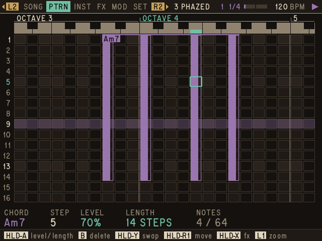

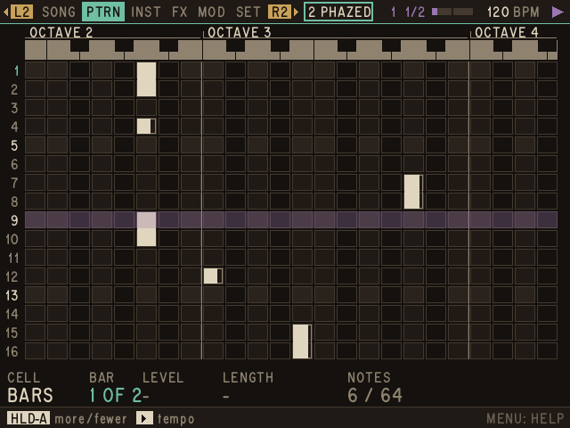

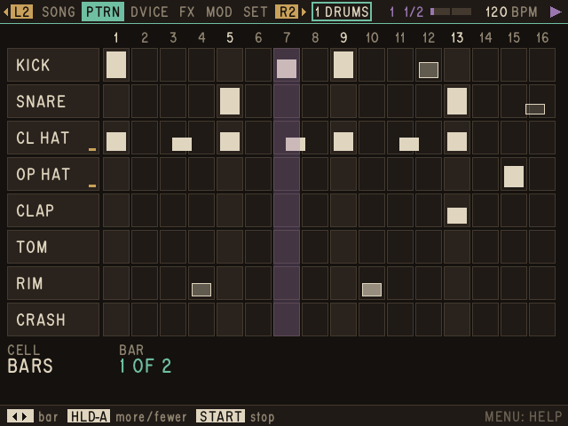

A **cell** (one track in one scene) can be **1, 2, 4 or 8 bars** long.

- **Hold A on a cell and push the stick left / right** to set its length. A
  tap of A still opens it.
- **A cell made longer is filled with itself.** One bar to two: the second
  bar is the first again, hits, notes, step effects and automation, ready to
  be changed. Two to four: bars 3 and 4 are bars 1 and 2. Only empty bars are
  filled: a bar you wrote and then hid by shortening the cell comes back as
  it was. It is one step of undo.
- **The scene lasts as long as its longest cell.** A shorter cell goes round
  under it: a one-bar drum loop plays four times under a four-bar part.
- A shorter cell is drawn again for each time it goes round, a little dimmer,
  with a thin line where it starts over.
- **The repeat count is whole passes of the scene.** A four-bar scene at x2
  is eight bars.
- On the PATTERN screen the grid shows one bar. Run the cursor off the end
  of step 16 and you are in the next bar; the top bar says **BAR 2 OF 4**.
  On the drum grid the lane's name is always one left of step 1.
- **Up from the top is the BARS stop** (up from the tempo on the drums, up
  from step 1 of bar 1 on the roll): left / right show the bar before or
  after, and hold A with up / down sets the cell's count. The bottom bar
  says so while you are there. Quicker, from anywhere on either grid:
  **hold L1, up / down** turns to the bar before or after, and **hold L1,
  left / right** sets the cell's count.
- On the piano roll **a note may run on over the bar lines**, to the end of
  the cell. In the bars after, it shows faint from the top; it is changed
  in the bar it starts in.
- While it plays, the top bar shows the bar of the scene (2/4) beside the
  progress blocks.

### Copy a bar, paste it on another

On the drum grid (the slice view too) and the piano roll:

| Gesture | Does |
| --- | --- |
| **Hold L1, press R1** | **Copy** the bar on screen: BAR 1 COPIED (on the drums, as it is pressed; on the roll, as R1 is let go unmoved — moved, it carried instead) |
| **Hold L1, press A** | **Paste** it over the bar on screen: PASTED ON BAR 2, and the copy is cleared |

So steps 1-16 onto 17-32: on bar 1, hold L1 and press R1; run the cursor on
into bar 2; hold L1 and press A.

- **A paste replaces the whole bar.** On the drum grid every lane: each hit
  with its level, nudge, chance, start, step effects and THROW. On the roll
  its notes and chords, with everything they do.
- **It can go anywhere**: another bar of the cell, another cell, another
  scene, another track. The copy stays until the next copy, a new song too.
- **A drum bar only goes on a drum track. Notes go on any synth or sampler
  track.** Otherwise it says so and nothing changes.
- **A note that runs over the bar line keeps its length**, but stops at the
  end of the cell it lands in.
- **Automation goes with it only onto the same track.** Another track's lanes
  are other knobs, so there they are left as they were.
- **One step of undo** (SELECT + B). A paste onto a bar that is already the
  same does nothing and is no step.
- While L1 is held the bar at the bottom says what R1 and A do.

**SELECT** lists the songs: start a new one, or open another.

In the list:

- **Y** saves a rev of the open song, wherever the cursor is (X hears, so it
  saves nothing).
- **A on the open song** lists its revs. Its second row, **NEW NAME**, gives
  the song a new two-word name. Press again for another.
- **Hold B on a song for a second** deletes it; the row fills as you hold and
  says CANNOT BE UNDONE (nothing on the handheld brings it back). A
  tap of B only closes the list. A deleted song and its revs are moved to a
  `deleted` folder inside `songs`, not destroyed. One deleted under a name
  that is already there is kept beside it as `NAME 2` (then `NAME 3`).

**SELECT + D-pad** sets the tempo from any screen: up / down by 1, left /
right by 10.

**SELECT + L1 / R1** is the volume: quieter / louder, from any screen. A bar
shows it for a moment. The handheld's own volume buttons belong to its
firmware and may not reach a running program; if they do arrive as the usual
volume keys, they work too. It starts at 40% on the handheld and is
remembered between starts. Catch takes the sound before the volume, so a
quiet handheld still catches at full level.

The stick's speed, for everything it moves and turns on every screen, is one
number: `gStickSpeed` in `app/ui.hpp` (0.75: a quarter slower than first built).

## Files over WiFi

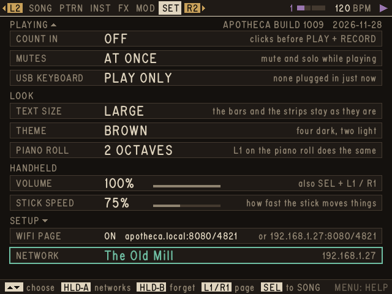

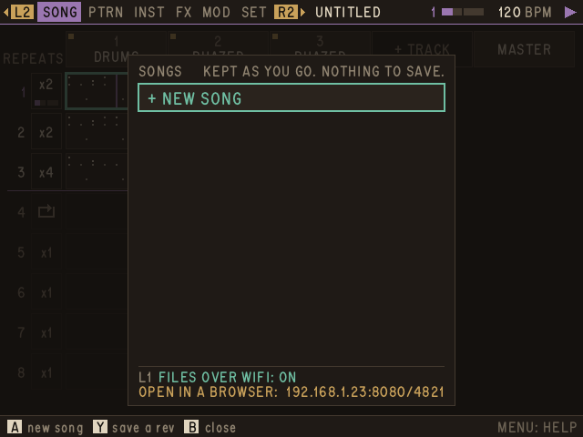

**L1 in the song list** turns it on. The list then shows an address, like
`192.168.1.23/4821` (`:8080` before the number on the stock firmware). Open it in a browser on any computer or phone on
the same network.

- **Send files**: CHOOSE FILES, or drop them on the page: recordings
  (`.wav`), chord packs (`.json`), songs (`.song`). Many at once is fine;
  they go one after another, each with a bar and a result: `saved`, or
  `refused` and why. A recording is on the kit screen at once; a chord pack
  is in the chord button's list on the next frame.
- **The song open on the handheld is not sent over.** A song sent under its
  name is refused ("that song is open on the handheld"): the handheld saves
  the song it has as you go, and would write over the one sent a moment
  later. Open another song on the handheld first, or send it under a new name.
- **Five wrong numbers** in the address, from anyone, and the page refuses
  every try for a minute ("too many wrong numbers: wait a minute"), the right
  number too. Then five more. A right number in between does not start the
  count again; a minute with no wrong number does. Turning WiFi off and on
  gives a new number and starts the count again.
- **A whole folder**: CHOOSE A FOLDER, or drop one on the page. Every `.wav`
  in it is sent, however deep its sub-folders go. Each sub-folder becomes
  one folder here (the handheld takes folders two deep, but a folder sent
  whole is still laid out one deep):
  `Pack/Drums/Kicks/808.wav` arrives as folder `Kicks`, file `808`. Two
  folders with one name get their parent's in front (`Drums Kicks`,
  `Vintage Kicks`). Names too long for the handheld (32 letters, 24 for a
  folder) are shortened by dropping words from the middle. **Nothing is sent
  until you have seen the plan**: how many, how big against the room on the
  card, which folders, which names change. Other files in the folder are left
  out. While it runs there is one row with a count and a STOP; only what is
  refused gets a row of its own.
- **SPEED TEST** (top of the page) times every instrument and effect on the
  device and shows the numbers in a new tab, each row as it is timed, the
  busiest song with 24 MODs running among them. Stop the song first; it takes
  about four minutes on the handheld. It also says how fast the
  processor is let run and what the sound card takes.
- **Recordings are shown by folder**, the loose ones as UNSORTED. Click a
  folder to open or shut it. FIND narrows the list by name.
- **To send into a folder**: drop the files on it, or press its ADD FILES
  (the way on a phone), or pick it under RECORDINGS GO IN. NEW FOLDER there
  takes a name; the folder is made when the first file lands in it.
- **PLAY** plays a recording or a bounce in the browser.
- **DOWNLOAD** fetches a file back: a catch, a recording, a song, a bounce.
- **Several at once.** Tick the box on each recording (or CHOOSE ALL on a
  folder; with something in the find box, that is every match). A bar comes up:
  pick a folder (or NEW FOLDER) and MOVE, or DELETE (it asks once more). They
  go one after another, each with its own line in the list at the top.
- **RENAME and MOVE** (recordings only) open a small form: the name, and the
  folder. On a computer a recording can also be dragged onto a folder.
  Nothing is written over: a name that is taken is refused. **The song that
  is open follows**: every lane and sampler track that used the old name uses
  the new one, the sound plays on without a gap, and the song is saved with
  it. **Every other song on the card follows too**, and every rev: each file
  that names the recording is rewritten with the new name and nothing else in
  it changes. It keeps its date, so the song list stays in the same order.
  Songs in `deleted` are left alone. With many songs this takes a moment
  after the move: the handheld does a few songs at a time and stays quick
  meanwhile.
- **DELETE** asks once more in the row (DELETE IT / KEEP). A recording, chord
  pack or bounce is gone for good. A song goes to `deleted` in the song
  folder with its revs, the same as one deleted on the handheld. **A folder
  stays when its last recording is deleted or moved out**, as on the
  handheld. An empty folder (no recording and no folder in it) shows DELETE
  FOLDER on its heading, which asks once more too. A folder with any other
  file in it is not deleted: the page says it is not empty.
- **Deleting a recording the open song uses**: the song keeps the name. The
  lane says NOT IN THE SAMPLES FOLDER at once and its built-in drum plays; a
  sampler track is silent. Send a recording of that name again (into any
  folder, if it is the only one of that name) and it is back on the next
  frame. Deleting a recording changes no saved song.
- The top line shows the version and the room left on the card.
- The four digits on the end are made up each time it is turned on. A
  request without them is refused, so someone on the network who has not
  seen the handheld's screen cannot get in. It is not encryption: use it on
  a network you trust.
- Every file is checked before it is kept: a plain name of the right kind
  (no `..`, nothing hidden; a recording may be one or two folders down,
  63 letters in all, nothing else may), 30 MB at most, and really a WAV, a chord pack or a song.
  Anything else is refused and nothing is written. Deleting, renaming and
  moving hold names to the same rules, and only touch a file that is there.
- It is off until turned on, and off again when Apotheca closes.
- The page is all in the handheld: it needs no internet.

For a script, the same things by hand (`ADDRESS` is what the screen shows):

| Job | Request |
| --- | --- |
| What is there | `GET ADDRESS/list` |
| Fetch | `GET ADDRESS/samples/kicks/808.wav` (also `songs`, `chords`, `bounces`) |
| Send | `PUT` to the same kind of address, the file as the body (not `bounces`) |
| Delete | `DELETE` the same address |
| Rename or move a recording | `POST` its address with a header `X-To: breaks/808.wav` (spaces as `%20`) |

**Updating Apotheca the same way.** The page has an UPDATE APOTHECA button:
choose the new `apotheca` program file (inside the `apotheca` folder of the
zip).

1. The page sends it. It is checked (a program for this processor, 30 MB at
   most) and only set aside. The network alone installs nothing.
2. The handheld shows AN UPDATE HAS ARRIVED. **Hold A for a second** to
   accept, or B to throw it away. Nothing else responds until it is answered.
3. Accepted, it is used the next time Apotheca starts. The program that was
   running is kept. Until then the right-hand end of the hints bar says
   **RESTART TO UPDATE**, on every screen. SELECT + START quits; start
   Apotheca again and the new one runs.
4. If the new one does not get going (it has to run for three seconds), the
   launcher goes back to the one before by itself and starts that.

One that nobody answers is dropped when WiFi is turned off or Apotheca is
closed. The first install still goes by SD card. Only the program is
updated this way: a new launcher script or fonts still come from the zip
(the chord packs that ship are inside the program).

The handheld has to be on a WiFi network already: set in the firmware's own
settings, or, on Apotheca's own system, on SET's NETWORK row (see "Joining a
network"), where the list also says the page's name, `apotheca.local`. Making its own hotspot, so no router is needed, is a job for the
Apotheca-only system image.

## Revs

A rev is a snapshot: the song as it is now, kept beside it and never written
to again.

- **SELECT, then Y** saves a rev (in the list of revs too).
- **SELECT, then A on the open song** lists its revs. A on one goes back to it.
- **Going back loses nothing.** If no rev holds the song as it is now, it is
  kept as a new rev first.
- Revs are files named `<song>.<number>.rev` in the `songs` folder, in the
  same text form as a song.

## Songs

- **Nothing to save.** The song is written to its file a couple of seconds
  after any change, and again on the way out.
- **The last song open comes back** at the next start.
- **New songs name themselves** with two words ("brass moth"), so nothing has
  to be typed on a D-pad.
- **Files** live in a `songs` folder beside the program, one `.song` text
  file each. They can be read by eye, copied and backed up. The format is
  described at the top of `app/song_file.hpp`.

## PATTERN, drums

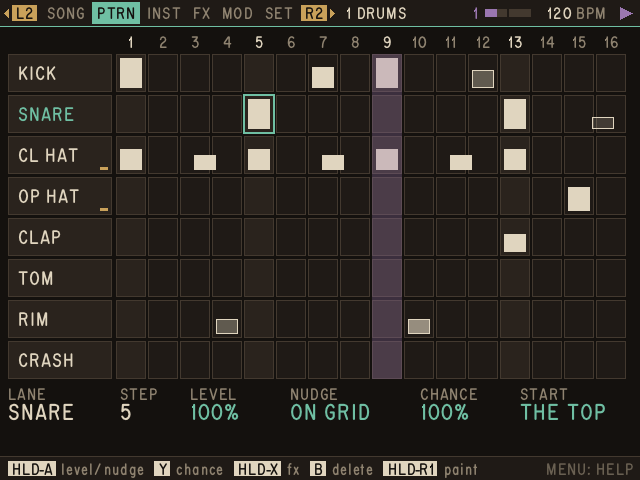

| Gesture | Sets | The block |
| --- | --- | --- |
| Hold A, stick up / down | Level | Fills or drains |
| Hold A, stick left / right | Nudge, up to half a step | Slides early or late |
| Hold A, **L2 / R2** | Nudge, a tenth of a step a press: L2 early, R2 late | The same |
| Hold Y, stick up / down | Chance | Fades toward a ghost |
| Hold Y, stick left / right | Start: where in the drum's sound the hit begins | A mark slides under it, and it is heard as it moves |

The stick does one of those per push. A places a hit, at 90% (a note or a
chord on the piano roll starts there too, and X or A hears a sound at that level
on every screen). Y places a "maybe"
(50%), or steps a hit's chance 100, 75, 50, 25. B deletes. X hears the lane:
on its name or an empty step, held, for as long as you hold it (a tap: a
moment). On a hit X is heard as the pattern plays it, whole.

Hold **B** and drag to delete every hit the cursor crosses.

**Hold L1 and press R1** to copy the bar on screen, **hold L1 and press A**
to paste it over the bar on screen (see "Copy a bar, paste it on another").
**Hold L1, up / down** turns to the bar before or after, round the ends;
**hold L1, left / right** sets the cell's bars, more or fewer (1, 2, 4 or 8,
as the SONG screen's hold A).
**Up from the tempo is the BARS stop**: left / right turn to the bar before
or after, round the ends; hold A with up / down sets the cell's bars, more
or fewer (1, 2, 4 or 8, as the SONG screen's hold A).

Hold **R1** and drag to paint hits at one level (the level of the hit you
started on, or 90%). **Add R2 while R1 is held** and the brush paints
random levels for as long as R2 is down. R2 by itself is "next screen", at
once.

The cursor can also sit on a lane's name, left of step 1: A plays the drum,
hold A + stick is its volume, **hold X is its FEEL** (see "FEEL" below), and Y is the **lane dice** (hold Y + stick up
and hits arrive in a shuffled order that leans toward the beat; down and
they leave; tap Y to reshuffle). **The dice work on every hit of the lane,
yours too**: down takes any hit away, a tap rolls the lane's hits anew (as
many as it has; an empty lane gets four, a full one eight). Undo puts yours
back. A full lane says THE LANE IS FULL, an empty one THE LANE IS EMPTY.

**EVEN** (a Euclidean rhythm): with Y held on a lane's name, **R1 is one hit
more and L1 one fewer, spread as evenly over the bar as sixteen steps allow**
(3 hits: steps 1, 7, 12; 4: every beat; 5: 1, 5, 8, 11, 14). From then until Y
is let go, **left / right turn the pattern a step** later or earlier. It writes
over the lane's bar as the dice do (a hit that stays where one was keeps its
level and effects; a new one is placed at 90%), the box says EVEN: 5 HITS,
TURNED 2, and undo puts the lane back.
Up from the top lane is the tempo: hold A + up / down turns it, and **A tapped in
time sets it** (from the second tap: the beat of the last five taps; a pause of
two seconds starts again). SETUP's TEMPO row taps the same way.

On a lane's name, hold Y and push **right** to roll a new start for every
hit on the lane, on the sixteenths of the sound. **Left** puts them all back
at the top. On a loop fitted to one bar, that rearranges the beat and keeps
it in time.

## The same on every screen

A few things mean one thing everywhere:

| | Means |
| --- | --- |
| A | Place, open, pick. Held: a direction shapes or turns what is under the cursor |
| B | Delete, empty, go back |
| **Hold B** | **Delete for good**: a track (2 s), a song (1 s), a recording in the list (1 s). The row fills as you hold; let go early and nothing happens |
| X | Hear it. A recording plays **for as long as X is held** (a tap: a moment). Held on a drum hit: its step effects. Held on a knob: its MOD |
| Hold R1 | On an empty step: paint as you drag. On a note: carry it. On SONG: copy a cell; R1 on another cell pastes it there |
| L2 / R2 | The tabs |
| **L3** (press the stick in) | **The SONG screen with MASTER under the cursor**: hold A + up / down is the output's level at once, whatever the handheld's own volume. L3 again (still on MASTER): back where you were |
| SELECT + something | Things about the whole song: undo, tempo, volume, WRITE, the scene's length, the next scene |

A held D-pad runs at one of two speeds on every screen: fast for a cursor
(33 moves a second), slow for a list or a choice (9 a second), so each one
can be seen or heard as it goes by.

On PRESET with A held, **left / right go eight presets at a time**, as in the
list of recordings.

## Step effects

What one hit does besides play. **Hold X on a hit** (a tap of X still just
hears it) and the stick or D-pad sets them, a click at a time, each heard as
it changes:

| Hold X and | Sets | On the block |
| --- | --- | --- |
| Up / down | **PITCH**: a semitone a click, an octave either way | A dash beside it, higher or lower |
| Left / right | **RATCHET**: the hit played 2, 3 or 4 times inside its step | Split into that many slivers |
| L1 | **REVERSE**: backwards, on and off | An arrow on its left |
| R1 | **CUT**: stopped after a step, half a step, a quarter; off | A red edge |
| A | **THROW**: this hit alone goes to ECHO, to SPACE, to both; off (see below) | A short bar above it: over its left half for ECHO, its right for SPACE |
| Y | **Dice**: rolls the first four for this hit. Mostly one effect, sometimes two. Always something, and never what it was. The dice leave THROW as it is. | |

- They combine, and every hit has its own. The strip under the grid spells
  them out; with X held it shows all five.
- A ratchet is rolled for once: with a chance below 100% it plays all its
  hits or none.
- Backwards plays what the hit would have played (its slice, or the sound
  from its start to the end) from the end to the start.
- A cut hit lasts its time whatever its pitch. In a ratchet each hit also
  stops when the next one comes.
- Kept in the song, undone by SELECT + B, and gone with the hit when it is
  deleted.
- A synth's notes have their own: see "Note effects" under PATTERN, a
  synth.

## FEEL: a lane played by a hand

**Each lane of a kit can be humanised, and it is live**: nothing is written
into the hits. Every time round the hits land a little differently, as a
drummer's do. A hit on a main beat (steps 1, 5, 9, 13) moves half as much as
one between them, so the beat stays put and what is between leans.

Put the cursor on a lane's **name**, **hold X** (a tap of X still just hears
the drum), and:

| Hold X and | Sets | At 100% |
| --- | --- | --- |
| Left / right | **HUMAN TIME**: OFF, 10, 25, 50, 75, 100% | Each hit up to 12 ms early or late (6 ms on a main beat) |
| Up / down | **HUMAN LEVEL**: the same six | Each hit up to 15% louder or quieter (7.5% on a main beat) |
| L1 / R1 | **SWING**: OFF, 10, 25, 50, 75, 100% (L1 less, R1 more) | Every second sixteenth a third of a step late: a triplet |
| Y | **Dice**: a small feel, OFF, 10 or 25% of each. Always something, never what it was. It leaves SWING alone | |
| A | **This lane's feel onto every lane** of the kit, its SWING too. From a lane at OFF, that clears them all | |

- With X held the strip under the grid shows SWING, HUMAN TIME, HUMAN LEVEL
  and EVERY LANE (COPY, or THE SAME once they are), each button under its field.
- **A lane with a feel wears a purple mark at the left of its name**: the
  upper piece for HUMAN TIME, the lower for HUMAN LEVEL. **A swung lane wears
  a purple long and short dash at the top right of its name.** With the cursor
  on the name the strip says all three in a line.
- It is the lane's, in every scene of the track. A new kit plays plain.
- **It is heard only as the pattern plays.** Set it while the song runs.
  Hearing a drum with X or A is always plain.
- It adds to what each hit has: its own nudge, its own level. A ratchet's
  hits move together and share one level.
- A hit written at full level can only get quieter (nothing is louder than
  full). At 90%, where A places them, it goes both ways (up to full).
- **Play from the top is the same performance again**, and a bounce is what
  was heard: the moves are worked out from where each hit is and which time
  round it is, not from luck at the moment.
- The song's very first hit cannot come before the top: it lands on it.
- **Slices in order still play as one unbroken sound.** A run of slices
  (each on the step after the last) moves as one, by its first hit's move,
  through the bar lines inside a cell too: a break two bars long, in order,
  is one run. Each slice still gets its own level. Where the cell goes
  round again a new run begins, with a move of its own.
- If the tempo is changed while the song plays, a hit that was waiting
  keeps its place in the step.
- A or Y pressed while X is held (COPY, the dice; THROW on a hit) does
  nothing more if X is let go first: let it go and press it again.
- CHANCE on a hit works as before.
- Kept in the song (a song without it is written as it always was), undone
  by SELECT + B, and in a bounce.

**SWING** plays the hits on steps 2, 4, 6 ... 16 late, the same every time
round (it is not a roll). The main beats are never swung.

| SWING | The off sixteenth comes | As drum machines print it |
| --- | --- | --- |
| 10% | 1/30 of a step late | 51.7% |
| 25% | 1/12 of a step late | 54.2% |
| 50% | 1/6 of a step late | 58.3% |
| 75% | 1/4 of a step late | 62.5% |
| 100% | 1/3 of a step late: each eighth played long and short, 2 to 1, as a triplet | 66.7% |

- It adds to a hit's own nudge and to HUMAN TIME.
- A ratcheted hit that is swung squeezes its hits into what is left of its
  step, so the last one ends before the next step's hit.
- **Slices in order still play as one unbroken sound**: a run takes the
  swing of its first hit. A break laid out in order on a swung lane is not
  swung inside; a run that starts on steps 2, 4 ... is moved late as a whole.
- **Nobody has listened to this yet** (FEEL or SWING). The tests measure where
  each hit lands and how loud; whether 12 ms and 15% are the right "most", and
  whether SWING's six steps are the right ones, is for ears.

## THROW

**One hit, or one note, sent in full to ECHO or SPACE.** The snare on beat
four gets the long echo; the rest of the bar stays dry. Hold **X** on the hit
or the note and press **A**: OFF, ECHO, SPACE, BOTH, and round again.

| | A thrown drum hit | A thrown note or chord |
| --- | --- | --- |
| What goes to the bus | That hit alone. The other drums of the track do not | The whole track, for as long as the note lasts. Other notes sounding then go with it |
| How | The drum is played a second time, straight into the bus | The track's send is opened for the note, and shut after it |
| The track's own effects | **Not on the thrown copy**: it is the plain drum | On it, as on any send |
| A ratchet | Every hit of it is thrown | The send stays open through all of them |
| A DUCK on the track | **Does not dip the thrown copy**: the bus gets the whole hit while the track dips | Dips what the bus gets, as it dips the track |
| Starts and stops | With the hit | Over 5 ms each way, so it does not click |

- **How loud is the bus's LEVEL** (FX, the bus's line). THROW has no amount
  of its own: it is a send at 100% for that hit or note.
- If the track's send is already up, THROW tops it up to 100%. It never adds
  on top.
- A muted track throws nothing. Stop and panic shut every send.
- A note's echoes ring on after the send has shut; what is cut is only the
  feed. The note's own fade (its release) after it is let go is not sent.
- In the slice view a thrown slice slides into the bus over a millisecond
  when the break is running on through it, so it does not tick.
- Kept in the song, undone by SELECT + B, copied with its bar, and in a
  bounce. Gone with the hit or the note.
- **A throw on the song's last step is whole in a bounce**: the bounce runs
  on until the echoes have died away (see BOUNCE). A thrown note there is
  stopped by the song's end like any note, so the bus gets what there was of
  it, and its echoes are kept.
- A DUCK on the master dips what comes back from ECHO and SPACE with the
  rest of the song.
- The dice do not throw.

## Slices: chopping a break

**L1 on a lane that plays a recording** zooms the grid into that one lane.
L1 again goes back. (L1 on the kit screen goes straight there too.) It acts
when L1 is let go: held, L1 is the key a bar is copied and pasted with (see
"Copy a bar, paste it on another"), and then letting go opens nothing.

The recording is drawn large and cut into **slices**: sixteen of them, or
one to a step if it is fitted to more than a bar (32 for two bars, 64 for
four). Under it are the bar's sixteen steps. A line runs from every hit up
to the slice it plays: straight down when the slice is the step's own,
crossing and purple when it has been moved.

Everything the grid does works the same here. What is added:

| Do this | To |
| --- | --- |
| Up / down on a hit | The next / previous slice, heard as it changes. It goes round the ends. |
| A on an empty step | Place a hit on the step's **own** slice (step 5 plays slice 5) |
| Hold R1 and drag | Lay the break out **in order**: a hit on every step crossed, each on its own slice |
| ...and R2 as well | A **random** slice on every step crossed: the break, shuffled |
| X | Hear one slice: the hit's, or on an empty step the one a hit would get |
| Up / down on the lane's name | Each hit plays **ONE SLICE** and stops, or **RUNS ON** through the recording until the next hit |
| Hold Y + right on the name | Roll every hit's slice. Left: back in order. |

So, to chop a break: put it on a lane, FIT it to 1 bar, L1, hold R1 and
sweep the stick across. That is the break as it was, in sixteen hits. Now
move to a step and press up or down until it plays the slice you want.

- **Slices in order play as one unbroken sound.** A hit that starts where
  the recording has just got to carries it on, with no gap or click. Only a
  slice out of order is heard as a cut.
- **ONE SLICE** is for beats with gaps: take a hit out and its step is
  silent. With **RUNS ON** the recording plays on through the gap.
- A hit's start can still be slid off the cuts (hold Y, stick left / right).
  The strip then reads `9 + 40%`: slice 9, and 40% of a slice further in.
- A slice change is undone by SELECT + B like any other edit. ONE SLICE /
  RUNS ON is kept in the song.

## DEVICE, drums: the kit

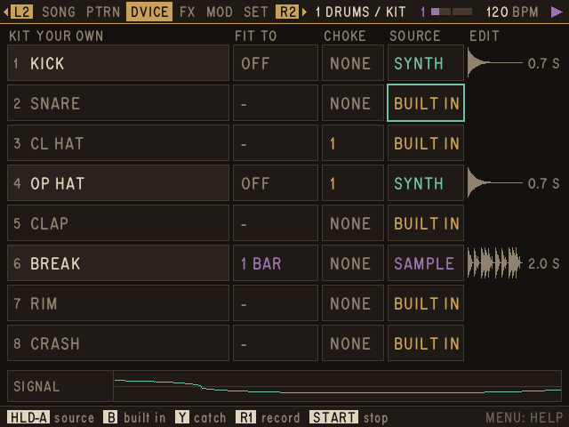

A row for each lane. Each lane plays its built-in drum, a **recording** (a
WAV file from the `samples` folder beside the program) or a **synth voice**
(a drum made from knobs: below). A kit can mix all three.
Left / right moves between the columns, SOUND, FIT TO, CHOKE and the sound's
picture, EDIT (round the ends).

**Kits.** UP from lane 1 is the kit's own stop, at the top left: KIT and its
name. Hold A + UP / DOWN there puts on the next / previous kit: seven
built-in kits (DRUMS, SYNTH, TIGHT, BIG, ELECTRO, DUSTY, HAND DRUMS), then
your own. B with A still held gives back the kit you had. Y saves the kit as
it is now as KIT 1, KIT 2... (a file `kit 1.kit` beside the presets). Hold B
a second deletes one of your own; the track keeps its sound. A kit is each
lane's sound with its EDIT, FIT, VOLUME, CHOKE, FEEL and SWING, not the
patterns or the effects. A changed kit reads YOUR OWN until it is saved.

| On | Hold A + stick up / down | B |
| --- | --- | --- |
| SOUND | From the built-in drum: UP each recording by name, DOWN the twelve synth models. Heard as it changes. | The drum back |
| FIT TO | Off, 1, 2, 4, 8 steps, 1 bar, 2 bars, 4 bars | Off |
| CHOKE | None, 1, 2 | None |
| EDIT | (A opens the lane's EDIT view, below) | |

**DRUM SYNTH: a lane's drum made from knobs.** Hold A + DOWN on SOUND from
the built-in drum steps through twelve models: KICK, SNARE, TOM, CLAP, CL
HAT, OP HAT, CYMBAL, RIM, COWBELL, CLAVE, ZAP and NOISE. The row reads the
model and SYNTH. **A tap of A on a synth lane's SOUND opens its VOICE
view**: the model and the sound's picture on top, its knobs under it (4 to
8 of them, each read in its unit; an empty box is a knob the model does not
have).

| Knob | What it does |
| --- | --- |
| TUNE | The drum's pitch (a kick 30 to 150 HZ, a hat's metal 100 to 600 HZ, a noise's filter 200 HZ to 14 KHZ) |
| DECAY | How long it takes to fall 60 dB |
| TONE | Brighter or darker: the click, the wires, the hats' high pass, a clap's or a noise's width |
| SNAP | The front: a beater's click, a snare's crack, a hat's first tick; on NOISE how fast it starts |
| NOISE | Noise mixed in: a snare's wires, the hats' noise against their metal, breath under a kick |
| SWEEP | How far the pitch falls at the start, in semitones |
| DRIVE | Pushed into a soft curve: louder body, flatter peaks |
| BEND, BODY, SPREAD | A model's own: how fast the SWEEP falls (KICK, TOM, ZAP), the snare's shell, the clap's bursts apart |

In the VOICE view: hold A + up / down turns a knob (the stick through its
whole range in about a second); on the model's box it steps the model, and
**hold A + left / right steps the model's named voices**: CLASSIC first,
then five to eight more, some the classic machines' kind, some odd (BOOM,
SUB DROP, BREATH, CLICKER, FINGER SNAP, GONG, WASH, ALARM, ROCKET, WIND...).
The voice's name stands in brass after the model while the knobs are its.
**The new sound is heard once, when you let go of A** (and it is made), not at every
step of the turn; X hears it at any time.
**Y rolls** the knobs (each somewhere in the middle of its range), B puts a
knob back (B again: back to the kit), **hold B** puts every knob back, L1 /
R1 go to the synth lane before / after, X hears it.

Every voice comes out at the same peak (-1 dB): the lane's VOLUME, EDIT's
GAIN and the mixer set how loud it is. **It is made into a sound when a knob
turns, and the engine plays that as it plays a recording**, so it costs
nothing while the song plays, and FIT, slices, EDIT, CHOKE, FEEL, THROW and
a bounce all work on it. A long one (a six-second cymbal) is made on a
helper thread and the lane plays what it had until it is ready. The song
keeps the model and its knobs, not a file. **Nobody has heard these drums
yet**: they are tested by numbers (pitch, decay, peak, how each knob moves
the sound), not by ear.

**EDIT: cut, turn round, pitch and level a lane's sound, without touching
the file.** A on the sound's picture opens the lane's EDIT view: the whole
file drawn large, the part played lit between two purple marks, as loud as
the edits make it, and eight boxes laid out as the sampler's.

| Box | What it does | D-pad step |
| --- | --- | --- |
| START, END | The part of the file played. Never closer than 5 ms. | 1 ms of the file |
| FADE IN, FADE OUT | A straight fade at each end of what is heard (0 ms to 2 s) | The next stop: 0, 1, 2, 3, 5, 10 ... 2000 ms |
| GAIN | -24 to +24 dB | Half a dB |
| PITCH, FINE | Played faster or slower (and so shorter or longer): two octaves either way, then up to half a semitone in cents | A semitone, a cent |
| REVERSE | The whole of the part played, end first | On / off |

- **Hold A + up / down turns a box**; the stick turns it through its whole
  range in about a second (gently with a little push). **A box turned is heard
  once, when you let go of A** (and the new sound is made), with the song stopped. **X hears the lane as edited** (held: to its end).
- **B gives a box its usual value; B on a box already there goes back to the
  kit. Hold B: every edit of the lane back to none**, as the bar fills. Undo
  brings them back.
- **Y on START or END: TRIM SILENCE** (START a millisecond before the first
  sound, END after the last: under 40 dB below its loudest is silence).
  **Y anywhere else: NORMALIZE**: GAIN so the part played peaks at about
  -1 dB, never over it. Both only set the boxes, and are undone like any edit.
- **The file on the card is never written.** The lane plays a copy made from
  it whenever an edit changes, so FIT stretches the edited sound, slices cut
  it (a trimmed break slices into its trimmed part), and slices in order still
  carry on without a seam. Catch and a bounce take it as heard. The hit's own
  step effects (pitch, reverse, cut) go on top.
- **The built-in drums take the same edits.**
- **Full scale is never passed.** From -0.9 dB up a sample is rounded softly
  into full scale, so GAIN past full flattens the peaks instead of clipping
  hard. (On any edited lane, so a sound already peaking over -0.9 dB is
  rounded a hair even at GAIN 0.)
- A cut edge always fades over 1 ms, so a trim never clicks; an edge that is
  the file's own start or end is left as it is.
- **A long sound pitched is made in the background**: the box reads the new
  value at once, the lane plays what it had for a moment, and the picture says
  MAKING IT... (a 10 s file two octaves down is a tenth of a second on a desk
  computer, about a second or two on the handheld). Short sounds are made at
  once.
- **Another recording on the lane puts START and END back to the whole of
  it**; the rest of the edits stay. On the kit page an edited lane's seconds
  are purple.
- Kept with the song (`laneedit` lines), and undone like a sound is.

**CHOKE: a hit cuts the other lanes of its group.** Each lane is in no
group, CHOKE 1 or CHOKE 2. A hit on a lane in a group fades out every other
lane of that group still sounding, over 3 ms (the fade a lane already cuts
its own last hit with). The usual case: **the closed hat cuts the open hat**,
and **a new kit has its two hats (lanes 3 and 4) in CHOKE 1** already: a new
drum track, a new song's kit, a track given the kit. A song made before
CHOKE has no groups.

- Two hits of one group on the same step both play: both were written.
- Every hit counts: each piece of a ratchet, a slice that carries the sound
  on, a hit by hand with X. A ratchet's later piece on the lane that was cut
  plays again.
- A hit thrown to ECHO or SPACE is cut on the bus too.
- A lane alone in a group plays as it would in none. Changing a group cuts
  nothing by itself.
- On the PATTERN tab a lane in a group has a small brass mark at the bottom
  right of its name: one dash for CHOKE 1, two for CHOKE 2.
- Kept with the song, and undone like a sound is.

**X hears the lane. Hold X and a recording plays for as long as you hold it**,
to its end; let go and it fades out. A tap plays a moment (0.35 s); a
built-in drum tapped plays whole. Another
screen, another track, Play or a new song stops it.

**L1 is Slices**: the PATTERN tab, zoomed into this lane's recording cut
into slices (see "Slices: chopping a break").

**Y is Catch.** The engine remembers the last ten seconds it played. Y on a
lane takes the last whole bar the song played, everything as it was heard,
saves it as `catch 1.wav`, `catch 2.wav`... in `samples/catches`, and puts
it on that lane fitted to one bar. It works just after stopping too. With no
whole bar to take (the first bar, or after playing by hand), it takes the
last bar's worth of sound.

**R1 is Record.** With a USB microphone or audio interface plugged into the
USB-C port: R1 on a lane starts it waiting for sound, so there is no silence
on the front. R1 again stops it; it stops by itself at twenty seconds. Silence
on the end is trimmed, a quiet take is brought up, and it is saved as
`rec 1.wav`, `rec 2.wav`... in `samples/recorded` and put on the lane. The sampler has the same
button. Not tried on the handheld yet: it depends on the firmware seeing the
USB device, which `apotheca.log` reports at startup ("audio inputs").

**FIT** stretches the recording, at the same pitch, to last that many steps
at the song's tempo. Change the tempo and it is fitted again, a quarter of a
second after the tempo stops moving. The work is done ahead of time on
another thread and swapped in when ready, so it never costs the sound
anything while playing. Until it is ready the lane plays what it had.

- WAV files of 8, 16, 24 or 32 bits or 32-bit float, any sample rate, any
  number of channels. They are played as one channel at 48 kHz.
- **Twenty seconds** of each is used; a longer file is cut there, with a short fade so it does not click.
- The song file keeps each lane's file by name and each hit's start. If the
  file is not on the card, the lane plays its drum and says so (FILE NOT
  FOUND. THE DRUM PLAYS.).
- The stretching is done by **Signalsmith Stretch** (MIT licence, in
  `third_party/signalsmith`). A recording too short for it, under about a
  tenth of a second, is done by a simpler method of our own
  (`app/stretch.hpp` says how both are used).

## PATTERN, a synth

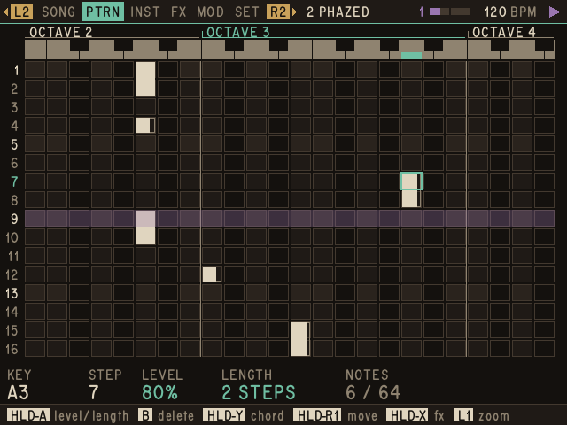

A piano roll on its side. The keys run across the top, laid out as a
keyboard is, two octaves at a time (L1 zooms: one, two or three). The bar runs down the screen, step 1
at the top. A note is as tall as it is long, and filled across as far as it
is loud; holding A shapes it the way it is drawn.

| Gesture | Does |
| --- | --- |
| Stick or D-pad left / right | Along the keys (they scroll) |
| Stick or D-pad up / down | Through the bar |
| A | Place a note, one step long |
| Hold A, left / right | Level |
| Hold A, **stick** up / down | Length, freely: the note's end follows the stick to any point in a step |
| Hold A, **D-pad** up / down | Length by whole steps: the end goes to the next step line, or the one before |
| Hold A, **L2 / R2** | Nudge: the note a tenth of a step early (L2) or late (R2), up to half a step. It sits a little above or below its line. |
| B | Delete the note under the cursor |
| X | Hear the key (on a sampler track, on an empty place: for as long as X is held) |
| Hold R1 and drag | Paint a note on every step crossed |
| Hold B and drag | Delete every note (or chord) the cursor crosses |
| **Hold X on a note**, left / right | **RATCHET**: the note played 2, 3 or 4 times inside its first step |
| **Hold X on a note**, up / down | **GLIDE**: up is one length longer, down one shorter, down to OFF. The note slides in from the note before it |
| **Hold X on a note**, A | **THROW**: the note goes to ECHO, to SPACE, to both; off |
| **Hold X on a note**, L1 / R1 | **GLIDE FROM**, for the whole track: which key of a chord its glides come from. R1 is the next of TOP, PAIRED, NEAREST, RANDOM; L1 the one before. It stops at each end |
| **Hold R1 on a note** and move | Carry the note (or the whole chord) under the cursor. **D-pad:** to another key, or a whole step. **Stick up / down:** it slides freely in time, off the grid. **L1 held:** left / right go an octave at a time. It stops at the ends of the bar and will not land on another note. |
| L1 | Zoom: a tap goes closer (2 octaves, 1, then round to 3) |
| Hold L1, up / down | The bar before or after, round the ends, from anywhere on the grid |
| Hold L1, left / right | The cell's count, more or fewer (1, 2, 4 or 8, as the SONG screen's hold A). One step of undo |
| BARS (up from step 1 of bar 1) | Left / right: the bar before or after, round the ends. **Hold A, up / down**: the cell's count, more or fewer (1, 2, 4 or 8, as the SONG screen's hold A). One step of undo |
| Hold L1, R1 / A | **Copy** the bar on screen (let go of R1 unmoved) / **paste** it over the bar on screen (see "Copy a bar, paste it on another"). The tap's zoom does not happen as well |

A note runs at most to the end of the bar, or to the next note on that key.
It can be as short as a tenth of a step. The engine lets go of each note on
its own sample, not on a step line.

**A note under a held chord still shows.** A note written where a chord (or a
longer note) is already sounding on the same key is drawn on top of it,
narrower, with a dark edge: a note inside a note.

## Note effects

Hold **X** on a note. The D-pad or the stick sets what the note does besides
play, one click per push. The strip at the bottom shows the values.

| Effect | Does | On a chord |
| --- | --- | --- |
| **RATCHET** (left / right) | The note 2, 3 or 4 times, evenly, inside its first step. Each is let go just before the next. The last is held for the rest of the note. | Yes: the whole chord repeats. It is one of a chord's six effects (see "Chord effects") |
| **GLIDE** (up = longer, down = shorter) | The note starts at the pitch of the note before it and slides to its own. How long the slide takes is the setting: OFF, 1/4 STEP, 1/2 STEP, 1 STEP, 2 STEPS or FULL. | No: a chord has no one note to slide from |
| **THROW** (A) | The track is sent in full to ECHO, SPACE or both for as long as the note lasts (see "THROW" under PATTERN, drums). A foot at the note's end: on the left for ECHO, the right for SPACE. | Yes: the whole chord |
| **Dice** (Y) | Rolls a ratchet, a glide of some length, or both. Always something, and never what it was. THROW is left as it is. | Rolls among the chord's six |

- A note with an effect carries a mark, so it can be told from a plain one.
- **On a chord the directions are shared out differently**: up / down pick
  one of six effects, left / right set it. See "Chord effects".
- With both set, only the first of the ratchet glides.
- A note too short for its ratchet plays as many as fit.
- Kept in the song, undone by SELECT + B, gone with the note.

**GLIDE, in full.** You set it on the note you slide *to*.

| Thing | How it works |
| --- | --- |
| Which note it slides from | The last note the track began before this one, on any key. After a chord (or any notes that began together), **GLIDE FROM** says which of its keys: see below. |
| The lengths | In steps, so they follow the tempo. **FULL** takes as long as it has been since the note it slides from began: a slow slide between two notes far apart, a quick one between two close together. |
| The line on the roll | A slanted purple line. It starts on the key the note slides from and ends at the note's start. Its height is the slide's length. The slide itself is heard from the note's start on. |
| A slide over more than one bar | FULL from a note bars back: the line is in every bar it crosses, from the bar its source note is in to the bar of its own note. |
| Into step 1 | The note slides from the last note of the loop. Its line is at the foot of the bar before (the same bar, in a one-bar cell), running off the bottom. |
| A key off the side of the roll | The line runs off that side. |
| Nothing to slide from | The first note after pressing play, and a note on the same key as the one before: no slide, no line. The corner mark stays. |
| Notes that begin together | None slides from another of them. Each slides from the note before them all. |
| With a ratchet | The slide is over before the second piece: at most 85% of the first piece, however long it is set. |
| The strip | With X held: GLIDE and its length, and the track's GLIDE FROM where NUDGE stands otherwise. Without: the length under GLIDE, or "x3 GLIDE" beside a ratchet. |
| Old songs | A glide that was ON is 1/2 STEP, which is what it was. On Phazed it was 92 ms at any tempo; it is now half a step there too. |

**GLIDE FROM: which key of a chord a glide comes from.** A setting of the
**track**, not of a note. Hold **X** on any note; **R1** is the next, **L1**
the one before. Every line on the roll moves at once.

"Moment" below: notes that begin together (a chord, or loose notes on one
step). A single note after a single note is the same under every type.

| Type | Each gliding note comes from | 4 keys, then 2 notes | 2 keys, then 4 notes |
| --- | --- | --- | --- |
| **TOP** | The highest key of the moment before. What it always did. | Both from the top key | All four from the upper key |
| **PAIRED** | Its opposite number, by pitch order: lowest from lowest, highest from highest, those between spread evenly. One note alone: from the top. | Bottom from bottom, top from top | Lower two from the lower key, upper two from the upper |
| **NEAREST** | The key nearest in pitch. A tie: the higher. Its own key: no slide. | Each from whichever key is closest | The same |
| **RANDOM** | A key of the moment before, rolled each time it plays. Play from the top gives the same rolls again. | Each from any of the four | Each from either |

| Thing | How it works |
| --- | --- |
| PAIRED counts every note of the moment | A chord's keys too, gliding or not. So a bass note under a chord comes from the bottom of the chord before, a melody note over it from the top. |
| FULL | As long as it has been since that moment began, whichever of its keys is picked. |
| RANDOM on the roll | The lines are as they are the first time the scene plays after Play. Later times round roll anew. |
| The strip, X held | GLIDE FROM and its value: dim while this note has no glide, brass when it is not TOP. |
| The dice | Leave it alone. It is the track's. |
| Undo | Takes it back, as a step of its own (SELECT + B). |
| In the song file | `glidefrom 1` (PAIRED), `2` (NEAREST), `3` (RANDOM), on a line of the track's own. Nothing at TOP. |
| Not on a chord | X held on a chord shows the chord's six effects; L1 / R1 there are as they were. |
| A known oddity | PAIRED, two notes under half a millisecond apart with a step line between them: the first is taken as a note alone (from the top). |

## Chords

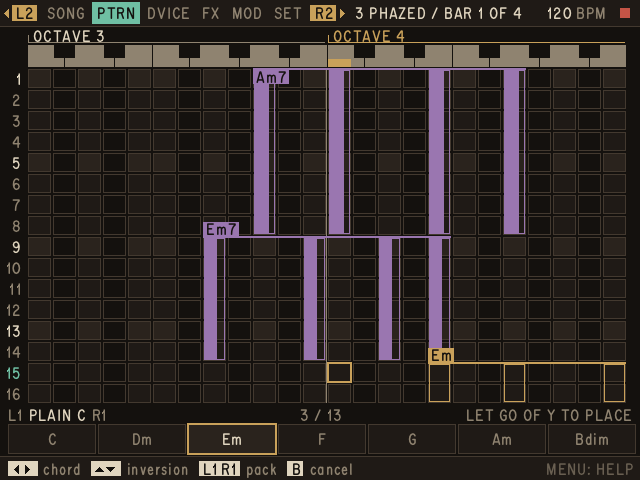

Y is the chord button. Chords come from the song's chord pack.

| Gesture | Does |
| --- | --- |
| Hold Y | The pack's chords appear along the bottom; the one in hand sounds |
| ...left / right | The next chord (stick or D-pad, either) |
| ...up / down | Inversion: the bottom note goes up an octave, or the top one comes down |
| ...L1 / R1 | Another pack |
| ...X | Hear it again |
| Let go of Y | The chord lands at the cursor, and the cursor moves on past it |
| ...B first | Nothing lands |

So a tap of Y places the chord in hand again; hold, flick, let go places a
different one.

**A chord stays a chord**: one block, with one level, one length and its
name. Chords never overlap in time.

- Cursor on one of its notes: hold A to set the level and length of the
  whole chord, B to remove it.
- Cursor anywhere in its steps: hold Y to swap it for another chord in
  place. B while Y is held breaks it into loose notes instead.
- A new chord is as long as the last one you set.

**Twenty packs come with the program**, all in C (nobody has heard the
thirteen added on 2026-11-17; their notes are checked by the tests):

| Pack | Chords | For |
| --- | --- | --- |
| Plain C | 13 | the plain chords of C major |
| Afterglow | 12 | warm major, sixths and upper extensions, a few borrowed from minor |
| Delta | 18 | blues: every chord a seventh, the twelve-bar, 9ths, 13ths, the sharp nine, a minor blues |
| Elegy | 23 | minor and harmonic minor: the major five, the diminished seventh, the lament, the line cliche |
| Ember | 17 | phrygian: the flat second over the tonic, the Spanish turn |
| Glass | 10 | clear pentatonic fragments, mostly three voices |
| Haze | 15 | ambient: close seconds, suspended stacks, chords over a held C |
| Hearth | 17 | folk: open triads voiced as a guitar holds them |
| Hollow | 17 | dark: minor-major sevenths, augmented and diminished, minor chords a tritone away |
| Horizon | 19 | cinematic: wide fifths, the rising six-three-seven, chords a third away |
| Luminous | 7 | bright lydian |
| Moonlit | 7 | dorian minor |
| Revival | 18 | gospel: walk-ups through diminished chords, the four over the five, the flat six |
| Skyline | 22 | city pop: the four-five-three-six road, major sevenths, secondary dominants |
| Smoke | 23 | jazz: two-five-ones with 9ths and 13ths, altered dominants, the tritone substitute |
| Stone | 15 | fourths: chords stacked in fourths, the modal eleventh |
| Strobe | 15 | deep house stabs: close minor sevenths, ninths and elevenths |
| Tidal | 12 | flowing mixolydian |
| Velvet | 18 | neo-soul: minor ninths and elevenths, lush major sevenths |
| Weightless | 8 | suspended and quartal |

They are built into the program, so an update over WiFi brings them. More are
JSON files in the form Shapetaker's Transmutation reads, in a `chords` folder
beside the program (`assets/chords` in this repository holds the ones that
ship). Drop a file in and it shows up; one with the name of a pack that ships
takes its place. What is read from a pack is listed at the top of
`app/chords.hpp`. A song file stores each chord whole, so a song still plays
on a device without its pack.
A bar holds 64 notes, chords' notes included, and 16 chords.

## Chord effects

**A chord that sounds played by a hand, or an arpeggio.** Hold **X** on any
note of a chord. **Up / down picks the effect, left / right sets it**, one
click per push, stick or D-pad. The strip lists all six and marks the one
picked. X + A is still THROW, X + Y still the dice.

| Effect | Values | Does |
| --- | --- | --- |
| **RATCHET** | OFF, x2, x3, x4 | The whole chord that many times inside its first step, as before |
| **STRUM** | OFF, STRUM, WIDE STRUM | The notes start one after another: 9 ms apart, or 26 ms. The first is on the chord's own moment, the rest land late. Each is held to the chord's end |
| | 1/4 STEP, 1/2 STEP, 1 STEP | **An arpeggio**: one note at a time, that far apart, round and round the chord's notes until the chord ends |
| **ORDER** | UP, DOWN, UP-DOWN, RANDOM | Which way STRUM runs. Does nothing with STRUM off (the strip shows it dim) |
| **HUMAN TIME** | OFF, 10, 25, 50, 75, 100% | Each note starts a little early or late. At 100%: up to 12 ms either way |
| **HUMAN LEVEL** | the same | Each note a little louder or quieter. At 100%: up to 15% of its level either way |
| **LENGTHS** | the same | Each note is let go a little sooner. At 100%: down to half. Never longer, so nothing runs into the next chord |

**Random means fresh every time the chord plays.** No two times round the
loop are alike. But pressing play from the top gives the same performance
again, so a bounce is what you heard from the top.

How the effects meet each other, and the edges:

| Thing | What happens |
| --- | --- |
| A strum on a short chord | The strum never takes more than half the chord's length. A shorter chord is strummed faster |
| STRUM with RATCHET | Every piece of the ratchet is strummed (within half of the piece) |
| RATCHET with any of the others | Every key plays as many hits as the plain chord does, every time. LENGTHS lets the **last** hit go sooner; the hits before it are as they always are |
| An arpeggio with RATCHET | The ratchet is not played. It is kept, and the strip shows it dim |
| An arpeggio past the chord's end | It never goes past. It goes round again through the notes until the chord ends; the last note is cut there |
| UP-DOWN on a strum | Up on one chord, down on the next, as a hand goes. Play starts with up |
| UP-DOWN on an arpeggio | Up, then back down, without playing the top or bottom twice |
| RANDOM on an arpeggio | A fresh order each time round the notes. With three notes or more, never the same note twice running |
| HUMAN TIME, early | The engine looks one step ahead, so a note really can come before the beat. **The song's very first chord cannot**: its early notes land on the first sample |
| HUMAN TIME in an arpeggio | A note never moves more than a quarter of the way to the next, so the order holds |
| HUMAN TIME and the next chord | A note that comes early can start up to 12 ms before the chord before it has ended |
| THROW | The send is open from the chord's first note to the chord's end, strummed or not, however short LENGTHS leaves the notes |
| GLIDE after the chord | A gliding note after it still slides from the chord's keys as written (which one: the track's GLIDE FROM; TOP is its top key), counted from the chord's own moment, as the roll draws it. A strum does not change that |
| X (hear) | Plays the chord plain, all at once. The effects are heard when the song plays |
| Swap (hold Y) | The new chord keeps the effects |
| Break into notes (hold Y, B) | The loose notes keep the ratchet and the THROW. **They keep nothing of the other five**: a strum belongs to a chord |
| Move (hold R1), copy, NEXT SCENE, undo | The effects go with the chord |
| The mark | A light corner at the top of **one** key: the chord's lowest, the one under its name. A ratchet's lines are on that key too, once, not on every key. Where the name sits on that key (a chord on step 1, or nudged early) both go on the next key, so nothing is written over the name. THROW's foot is on every key. A ratchet that is not played (an arpeggio) is not drawn |
| Changed while the song plays | The change is heard the next time the chord plays, and that time has each note once. An arpeggio stops at once if its chord is deleted, moved or made a plain chord |
| A bounce | The song is played once, so nothing of its first chord sounds at its end (live, going round, HUMAN TIME's early notes do come just before the bar line) |
| The dice (X + Y) | Always something, never what it was. A strum about half the time, an arpeggio about one roll in seven; human amounts only 10 or 25%; an arpeggio is never given a ratchet |

In the song file a chord's effects are one line after it, left out when none
is set: `chordplay STEP STRUM ORDER TIME LEVEL LENGTHS`. A program from
before chord effects skips the line and plays the chord plain.

## DEVICE, a synth

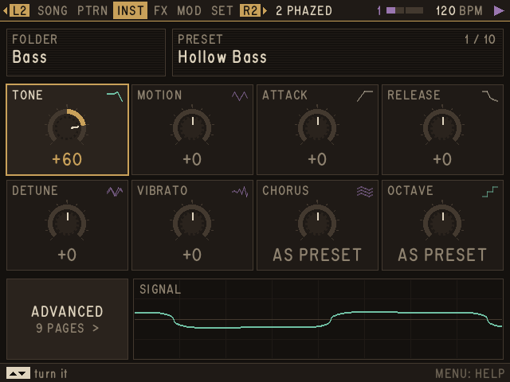

MAIN: folder, preset, eight macros and ADVANCED. Phazed's macros are TONE,
MOTION, ATTACK, RELEASE, DETUNE, VIBRATO, CHORUS, OCTAVE. JAX-EP's are
CUTOFF, RESO, ENV, TUNE, MIX, LFO, ATTACK, RELEASE. FM-6's are BRIGHT,
FEEDBACK, ATTACK, DECAY, RELEASE, DETUNE, LFO, PITCH ENV. PHYSIC's are TONE, POSITION,
DECAY, MATERIAL, STRETCH, RELEASE, DICE, OCTAVE. MORPH's are POSITION, MIX,
CUTOFF, RESO, ENV POS, ENV CUT, DETUNE, RELEASE. Hold A + stick turns the one under
the cursor; B puts a macro back in the middle. Each macro has a small picture
of what it does and a colour for its kind (teal: the sound's colour; purple:
movement and width; cream: time), and stays dim until it is turned. Macros bend the sound and
leave the preset as it was made. A new preset is played at once when the
song is stopped.

Phazed's DETUNE tunes the sound's second line (oscillator) up to a semitone
sharp or flat. A sound with only one line is given a copy of that line as
soon as DETUNE leaves the middle, so the macro does something on every
preset. Two things follow from the copy: notes that are sounding at that
moment fade out once, and such a sound then plays four notes at a time
instead of eight.

Phazed's 65 presets are in seven folders (Keys, Bass, Brass & Leads, Strings &
Pads, Bells & Plucks, Organs, Drums & FX). **48 more, in eight folders of their
own, are each a whole track sound** (the synth with its effects, sends and
MODs: "Presets" above): STAGE KEYS (a tine piano through tremolo, a worn
digital piano, a clav through a wah), DEEP BASS, LEADS, PADS, PLUCKS, BELLS,
DRONES and TEXTURES, six each. Each starts from one of the 65 and bends it.
Nobody has heard them yet; each was measured to play at a sane level, not
clip, end its tail and have every MOD change the sound (`presets_test
--heard-phazed`).

ADVANCED: every setting. Phazed has nine pages (the sound, each line, and
each line's volume, wave and pitch envelopes drawn out). JAX-EP has
five (DCO-1, DCO-2, VCF, VCA and envelope, LFO and chorus). FM-6 has eight
(the voice and its LFO, one for each operator, the pitch envelope: see FM-6,
above). PHYSIC has five (SOUND, RING, PLAY, DICE, BODY: see PHYSIC, above). L1 and
R1 turn the pages; B goes back to MAIN.

JAX-EP is a virtual analog synth modeled after a popular DCO synth, and its
pages are that synth's panel:

- **A knob reads as a dial, 0.0 to 10.0**, in tenths, on the handheld and on
  the designer page. A switch reads by its positions (RANGE 16', 8', 4'; WAVE
  SAW, PULSE, SQUARE; CROSS MOD OFF, SYNC, METAL).
- **A macro reads -100 to +100.** At +0 the setting is as the preset has it;
  below, it slides down to 0.0; above, up to 10.0.
- **Its 32 presets are two folders, BANK A and BANK B, sixteen each**: the
  sounds the synth it is modeled after came with, in their order (String I,
  String II, Organ I ... Planet, Jet). On FOLDER, hold A and press up or down
  to go from one bank to the other. A new JAX-EP track starts on the first.
  After them, presets that hold a track sound (effects, sends, MODs: "Presets"
  above), **126 in fourteen folders of their own**: PADS (Warm Pad, then pads that
  breathe, shimmer and bloom), STRINGS, BRASS, BASS (subs, an accented resonant
  line, sync growls, a dub sub), LEAD (single lines: sync, fuzz, vowels, a breath),
  KEYS (metal pianos, a rotor organ, a wah clavinet), PLUCK, SEQUENCE (for
  sixteenths: STEPPERS that accent, re-tune a synced DCO-2, pan and gate),
  SYNC & METAL (the two CROSS MODs), ATMOS (whistling noise, a worn radio, a
  haunted organ), CLASSIC 80S and MOVING (a MOD is most of the sound), then
  ORGAN and BELLS (eight each: drawbar, pipe and combo organs on the GATE;
  METAL and SYNC rings). The first 110 have at least one MOD each. Ten to try first: Tidal Pad, Bowed Sync, Acid Line,
  Dub Sub, Sync Scream, Suitcase Keys, Berlin Bass, Night Wind, Haunted Organ,
  Interval Walk. Nobody has heard them yet; each was measured to play at a
  sane level, never reach the VCA's clip (at full velocity too), end its tail
  and move its MODs (the synth's plan in `docs/plans`, "The second set of presets").
- **MAIN says 1983 BOOKLET, SPEEDS GUESSED beside PRESET.** The presets'
  settings are from a booklet of that year that prints each knob's value;
  they may not be the machine's own memory. And every time and rate in this
  synth (envelope times, LFO rate and delay, the chorus's sweep, where the
  filter's cutoff sits, how loud each step of LEVEL is) is a guess until it
  is measured from recordings. So a preset has the right settings and
  guessed speeds. One of your own presets says nothing.
  - **Twelve of them hold a guess of their own**: the booklet draws PULSE and
    SQUARE alike, told apart only by the angle of a knob (Organ II, both
    E. Pianos, Clavi, Vibraphone, Celesta, Flute, Oboe, Distortion Guitar,
    Sync Sweep, Funky Clavi, Planet). Pulsar's CROSS MOD is read as METAL.
  - **The filter's range and the loudness were set from the presets**
    (2026-11-15). CUTOFF 0 to 10 is 50 Hz to 20 kHz at middle C, placed so
    Organ I's filter sings the key played: it is in tune with the other
    tracks now. (At middle C the top of the knob, 8.7 to 10, is one sound:
    the filter is as open as it goes.) LEVEL follows the knob straight:
    LEVEL 5 is half as loud as LEVEL 10 (6 dB down), LEVEL 2.5 a quarter.
    The bank is about as loud as PHAZED's presets, and every one of the 32
    can be heard.
  - **No preset distorts as written.** LEVEL 10 with an ordinary wave is
    the full clean level. Only a wave over full there (the filter ringing
    hard, the macros turned up) bends a little, as too high a LEVEL does on
    the synth it is modeled after. Six keys of E. Piano I, the loudest,
    come out of the synth at about one and a half times full scale (the
    track's usual level takes it under).
  - **RESONANCE keeps the low end and sings only at the top** (2026-11-16).
    Turned up, it used to take a bass note down by about 14 dB and sing a
    loud whistle from 8.7 on. Now a bass note loses 4 to 5 dB at most, the
    filter starts to sing at 9.6, and at 10 it sings a round sine about as
    loud as the note's own lowest part, on the cutoff at any height. A preset
    with RESONANCE up has more low end than before (Harpsichord about 7 dB
    louder); those whose sound is the singing (Organ I, Voice, Pulsar) are
    1.5 dB quieter.
  - **A JAX-EP track saved by an older build loads as it was saved, and
    may sound different.** From builds 0.504 to 0.514: a sound at LEVEL 4
    or under is within 2 dB of what it was; higher LEVELs are quieter and
    clean (LEVEL 6 about 4 dB, LEVEL 8 about 10 dB before the old
    distortion, which is gone); E. Piano I and Voice no longer distort.
    From build 0.502 or earlier: brighter, and most sounds about 12 dB
    louder.
- **The number beside PRESET is the preset's place in its folder**: 7 / 16
  in BANK B is the booklet's B7. Your own presets are counted among
  themselves (every synth counts this way).
- **VELOCITY and BRILLIANCE (last page) belong to the track**, not to the
  preset: picking a preset leaves them as set.

How fast the drum grid moves is set in one place, `Feel` in
`app/pattern_screen.hpp`.

Keyboard stand-ins:

| Handheld | Key | | Handheld | Key |
| --- | --- | --- | --- | --- |
| D-pad | Arrow keys | | L1 / R1 | Q / W |
| A | X | | L2 / R2 | 1 / 2 |
| B | Z | | START | Return |
| X | S | | SELECT | Backspace |
| Y | A | | MENU | Tab |
| The stick | I J K L | | (quit, desk only) | Esc |

The button code lives in `app/input.hpp`. Nothing else in the app may read a
key or a gamepad button directly.
